# Free Tailwind CSS Templates

59 free, responsive website templates built with [Tailwind CSS](https://tailwindcss.com), for Business, Health & Fitness, SaaS, Agency, Blog and more sites. Plain HTML, no build step: open `index.html` and start editing.

Made by [Let's templates](https://letstemplates.com/?utm_campaign=free-templates&utm_content=intro&utm_medium=readme&utm_source=github), where you'll find 150+ templates in Tailwind CSS, Bootstrap 5, DaisyUI and Material Design.

⭐ **If these templates save you time, star the repo** so more people can find them.

## Templates

<table>
<tr>
<td width="50%" valign="top">
<a href="https://letstemplates.com/templates/tailwind/travel/skybound/demo?utm_campaign=free-templates&amp;utm_content=skybound&amp;utm_medium=readme&amp;utm_source=github">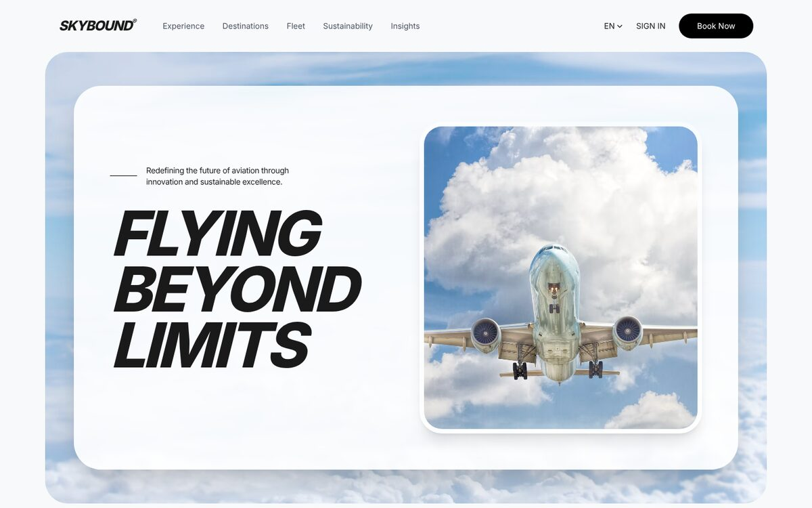</a><br><b>SkyBound</b> · Travel<br>
<a href="https://letstemplates.com/templates/tailwind/travel/skybound/demo?utm_campaign=free-templates&amp;utm_content=skybound&amp;utm_medium=readme&amp;utm_source=github">Live demo</a> · <a href="templates/skybound">Code</a> · <a href="https://letstemplates.com/templates/travel/skybound?utm_campaign=free-templates&amp;utm_content=skybound&amp;utm_medium=readme&amp;utm_source=github">Bootstrap, DaisyUI and Material Design versions</a>
</td>
<td width="50%" valign="top">
<a href="https://letstemplates.com/templates/tailwind/portfolio/julian-sterling/demo?utm_campaign=free-templates&amp;utm_content=julian-sterling&amp;utm_medium=readme&amp;utm_source=github">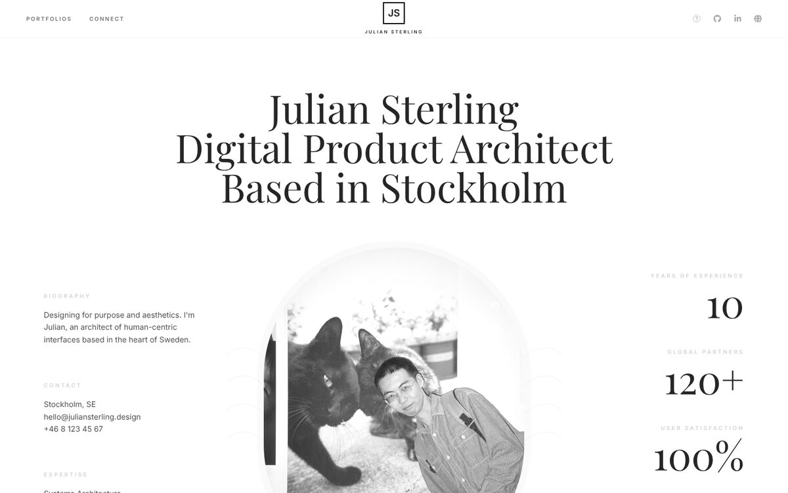</a><br><b>Julian Sterling</b> · Portfolio<br>
<a href="https://letstemplates.com/templates/tailwind/portfolio/julian-sterling/demo?utm_campaign=free-templates&amp;utm_content=julian-sterling&amp;utm_medium=readme&amp;utm_source=github">Live demo</a> · <a href="templates/julian-sterling">Code</a> · <a href="https://letstemplates.com/templates/portfolio/julian-sterling?utm_campaign=free-templates&amp;utm_content=julian-sterling&amp;utm_medium=readme&amp;utm_source=github">Bootstrap, DaisyUI and Material Design versions</a>
</td>
</tr>
<tr>
<td width="50%" valign="top">
<a href="https://letstemplates.com/templates/tailwind/travel/roamia/demo?utm_campaign=free-templates&amp;utm_content=roamia&amp;utm_medium=readme&amp;utm_source=github">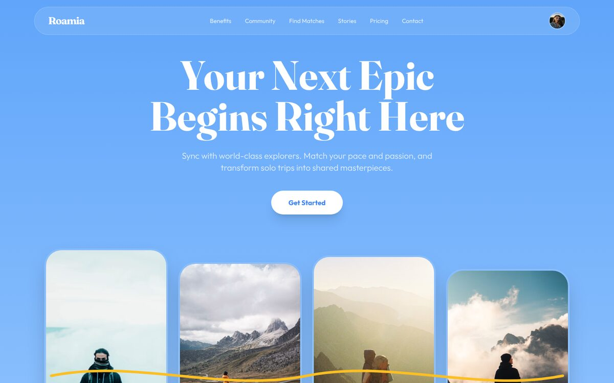</a><br><b>Roamia</b> · Travel<br>
<a href="https://letstemplates.com/templates/tailwind/travel/roamia/demo?utm_campaign=free-templates&amp;utm_content=roamia&amp;utm_medium=readme&amp;utm_source=github">Live demo</a> · <a href="templates/roamia">Code</a> · <a href="https://letstemplates.com/templates/travel/roamia?utm_campaign=free-templates&amp;utm_content=roamia&amp;utm_medium=readme&amp;utm_source=github">Bootstrap, DaisyUI and Material Design versions</a>
</td>
<td width="50%" valign="top">
<a href="https://letstemplates.com/templates/tailwind/agency/bold-horizon/demo?utm_campaign=free-templates&amp;utm_content=bold-horizon&amp;utm_medium=readme&amp;utm_source=github">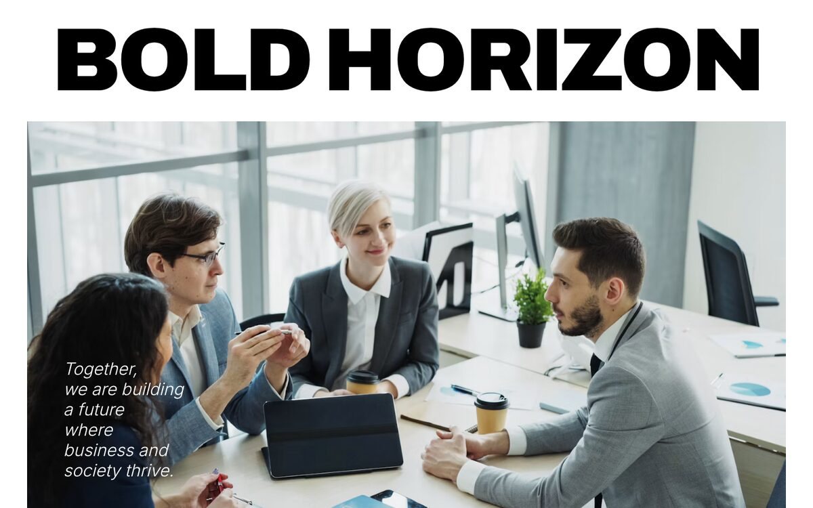</a><br><b>Bold Horizon</b> · Agency<br>
<a href="https://letstemplates.com/templates/tailwind/agency/bold-horizon/demo?utm_campaign=free-templates&amp;utm_content=bold-horizon&amp;utm_medium=readme&amp;utm_source=github">Live demo</a> · <a href="templates/bold-horizon">Code</a> · <a href="https://letstemplates.com/templates/agency/bold-horizon?utm_campaign=free-templates&amp;utm_content=bold-horizon&amp;utm_medium=readme&amp;utm_source=github">Bootstrap, DaisyUI and Material Design versions</a>
</td>
</tr>
<tr>
<td width="50%" valign="top">
<a href="https://letstemplates.com/templates/tailwind/business/fashora/demo?utm_campaign=free-templates&amp;utm_content=fashora&amp;utm_medium=readme&amp;utm_source=github">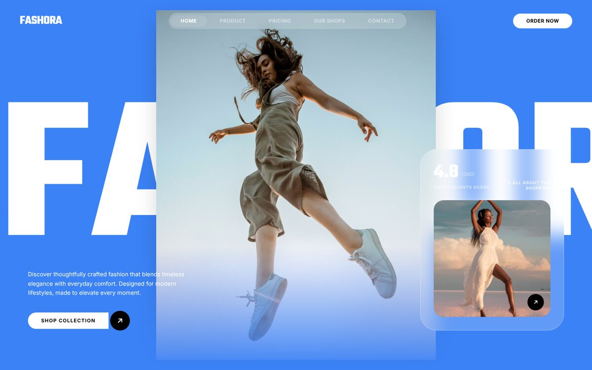</a><br><b>Fashora</b> · Business<br>
<a href="https://letstemplates.com/templates/tailwind/business/fashora/demo?utm_campaign=free-templates&amp;utm_content=fashora&amp;utm_medium=readme&amp;utm_source=github">Live demo</a> · <a href="templates/fashora">Code</a> · <a href="https://letstemplates.com/templates/business/fashora?utm_campaign=free-templates&amp;utm_content=fashora&amp;utm_medium=readme&amp;utm_source=github">Bootstrap, DaisyUI and Material Design versions</a>
</td>
<td width="50%" valign="top">
<a href="https://letstemplates.com/templates/tailwind/education/uniglobe/demo?utm_campaign=free-templates&amp;utm_content=uniglobe&amp;utm_medium=readme&amp;utm_source=github">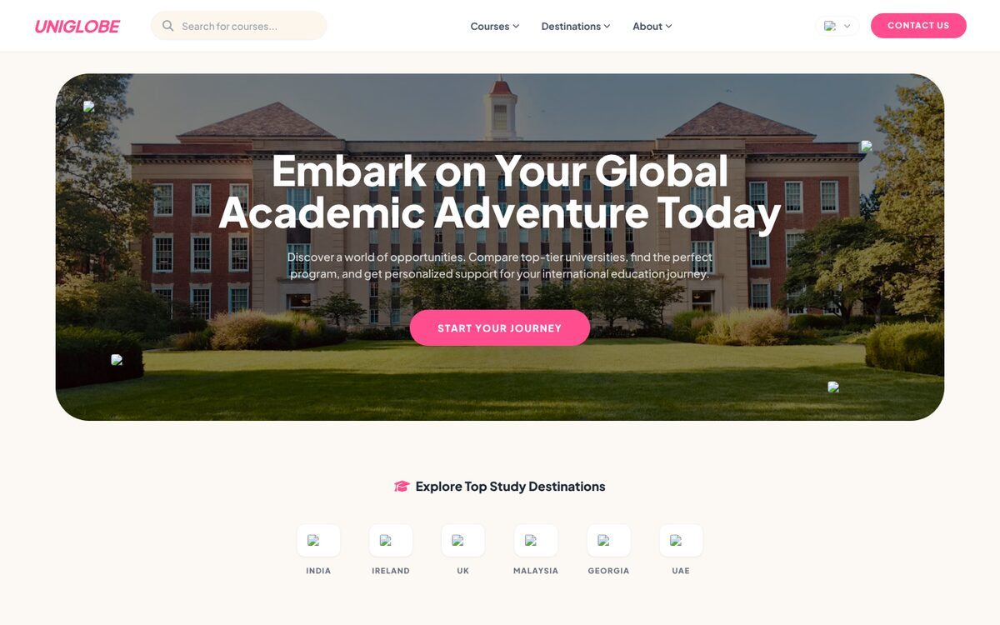</a><br><b>UniGlobe</b> · Education<br>
<a href="https://letstemplates.com/templates/tailwind/education/uniglobe/demo?utm_campaign=free-templates&amp;utm_content=uniglobe&amp;utm_medium=readme&amp;utm_source=github">Live demo</a> · <a href="templates/uniglobe">Code</a> · <a href="https://letstemplates.com/templates/education/uniglobe?utm_campaign=free-templates&amp;utm_content=uniglobe&amp;utm_medium=readme&amp;utm_source=github">Bootstrap, DaisyUI and Material Design versions</a>
</td>
</tr>
<tr>
<td width="50%" valign="top">
<a href="https://letstemplates.com/templates/tailwind/business/physiotech/demo?utm_campaign=free-templates&amp;utm_content=physiotech&amp;utm_medium=readme&amp;utm_source=github">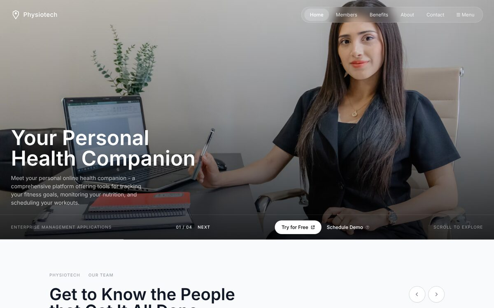</a><br><b>Physiotech</b> · Business<br>
<a href="https://letstemplates.com/templates/tailwind/business/physiotech/demo?utm_campaign=free-templates&amp;utm_content=physiotech&amp;utm_medium=readme&amp;utm_source=github">Live demo</a> · <a href="templates/physiotech">Code</a> · <a href="https://letstemplates.com/templates/business/physiotech?utm_campaign=free-templates&amp;utm_content=physiotech&amp;utm_medium=readme&amp;utm_source=github">Bootstrap, DaisyUI and Material Design versions</a>
</td>
<td width="50%" valign="top">
<a href="https://letstemplates.com/templates/tailwind/health-fitness/clinova/demo?utm_campaign=free-templates&amp;utm_content=clinova&amp;utm_medium=readme&amp;utm_source=github"></a><br><b>Clinova</b> · Health &amp; Fitness<br>
<a href="https://letstemplates.com/templates/tailwind/health-fitness/clinova/demo?utm_campaign=free-templates&amp;utm_content=clinova&amp;utm_medium=readme&amp;utm_source=github">Live demo</a> · <a href="templates/clinova">Code</a> · <a href="https://letstemplates.com/templates/health-fitness/clinova?utm_campaign=free-templates&amp;utm_content=clinova&amp;utm_medium=readme&amp;utm_source=github">Bootstrap, DaisyUI and Material Design versions</a>
</td>
</tr>
<tr>
<td width="50%" valign="top">
<a href="https://letstemplates.com/templates/tailwind/saas/nexora/demo?utm_campaign=free-templates&amp;utm_content=nexora&amp;utm_medium=readme&amp;utm_source=github">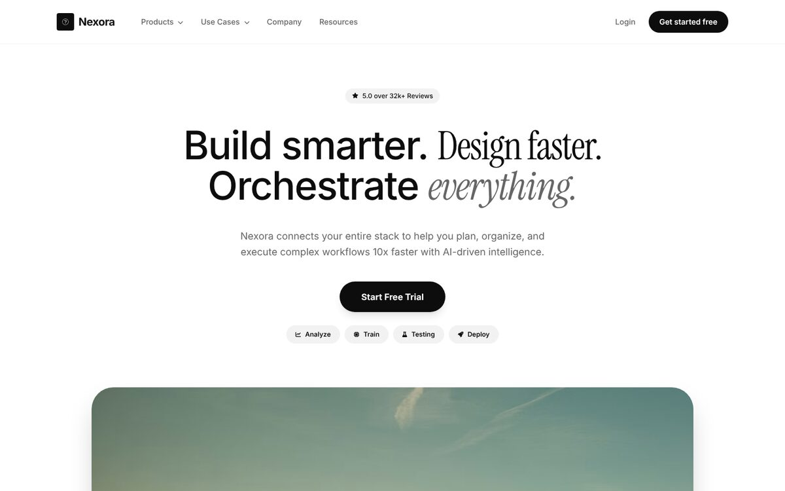</a><br><b>Nexora</b> · SaaS<br>
<a href="https://letstemplates.com/templates/tailwind/saas/nexora/demo?utm_campaign=free-templates&amp;utm_content=nexora&amp;utm_medium=readme&amp;utm_source=github">Live demo</a> · <a href="templates/nexora">Code</a> · <a href="https://letstemplates.com/templates/saas/nexora?utm_campaign=free-templates&amp;utm_content=nexora&amp;utm_medium=readme&amp;utm_source=github">Bootstrap, DaisyUI and Material Design versions</a>
</td>
<td width="50%" valign="top">
<a href="https://letstemplates.com/templates/tailwind/business/payme/demo?utm_campaign=free-templates&amp;utm_content=payme&amp;utm_medium=readme&amp;utm_source=github">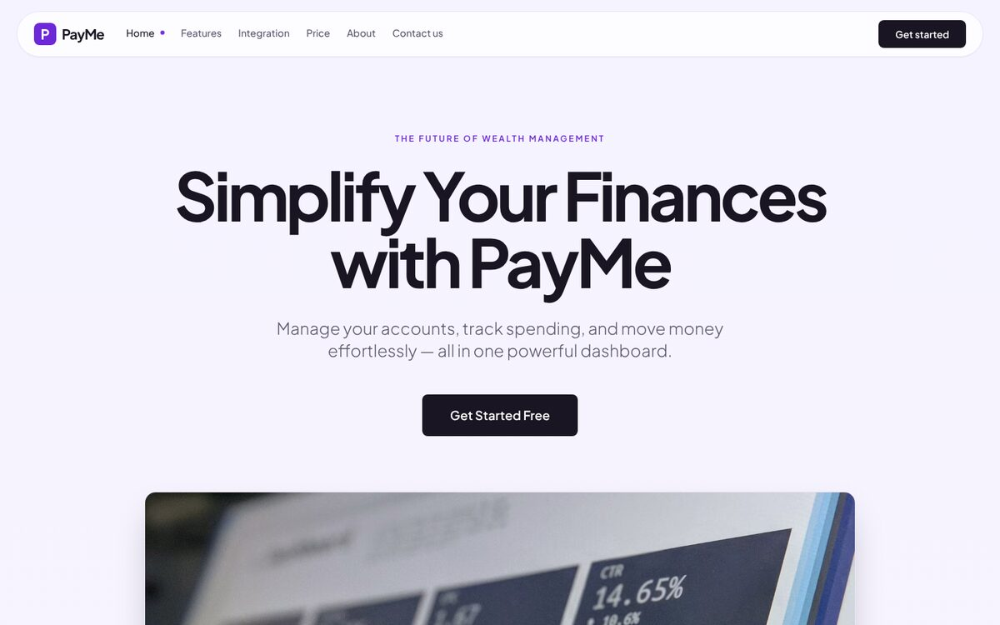</a><br><b>PayMe</b> · Business<br>
<a href="https://letstemplates.com/templates/tailwind/business/payme/demo?utm_campaign=free-templates&amp;utm_content=payme&amp;utm_medium=readme&amp;utm_source=github">Live demo</a> · <a href="templates/payme">Code</a> · <a href="https://letstemplates.com/templates/business/payme?utm_campaign=free-templates&amp;utm_content=payme&amp;utm_medium=readme&amp;utm_source=github">Bootstrap, DaisyUI and Material Design versions</a>
</td>
</tr>
<tr>
<td width="50%" valign="top">
<a href="https://letstemplates.com/templates/tailwind/portfolio/nexus/demo?utm_campaign=free-templates&amp;utm_content=nexus&amp;utm_medium=readme&amp;utm_source=github">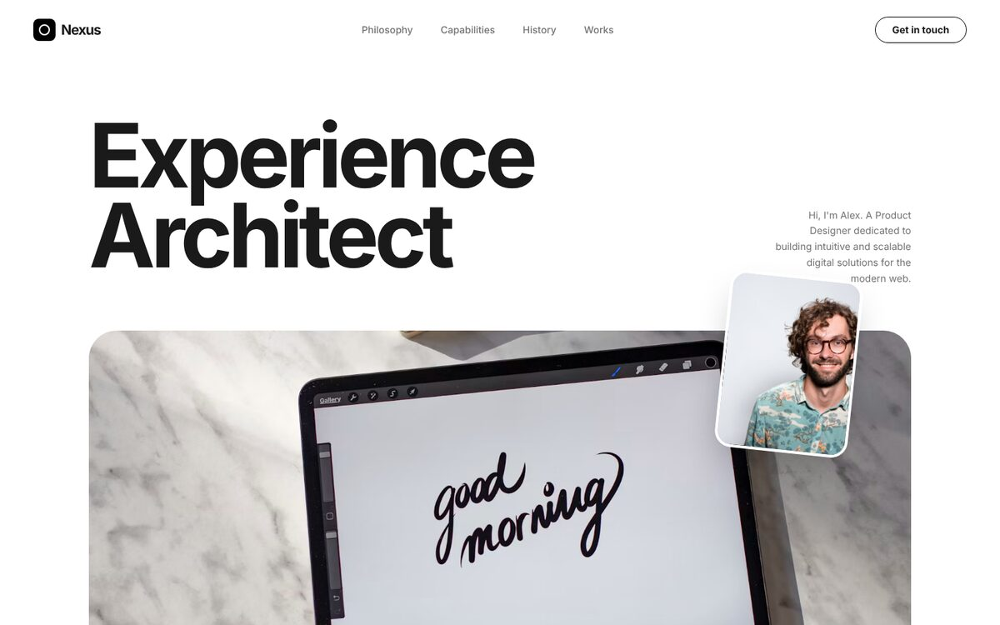</a><br><b>Nexus</b> · Portfolio<br>
<a href="https://letstemplates.com/templates/tailwind/portfolio/nexus/demo?utm_campaign=free-templates&amp;utm_content=nexus&amp;utm_medium=readme&amp;utm_source=github">Live demo</a> · <a href="templates/nexus">Code</a> · <a href="https://letstemplates.com/templates/portfolio/nexus?utm_campaign=free-templates&amp;utm_content=nexus&amp;utm_medium=readme&amp;utm_source=github">Bootstrap, DaisyUI and Material Design versions</a>
</td>
<td width="50%" valign="top">
<a href="https://letstemplates.com/templates/tailwind/food-restaurant/lumiere/demo?utm_campaign=free-templates&amp;utm_content=lumiere&amp;utm_medium=readme&amp;utm_source=github">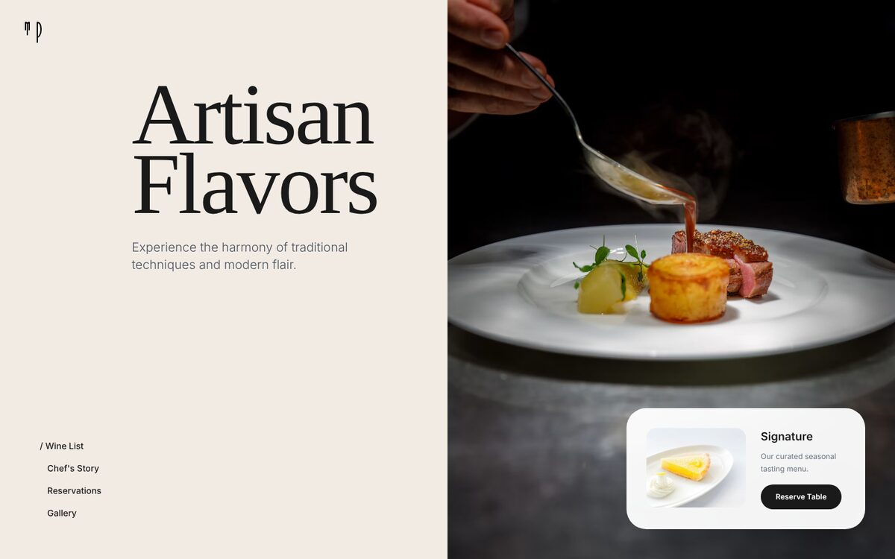</a><br><b>Lumière</b> · Food &amp; Restaurant<br>
<a href="https://letstemplates.com/templates/tailwind/food-restaurant/lumiere/demo?utm_campaign=free-templates&amp;utm_content=lumiere&amp;utm_medium=readme&amp;utm_source=github">Live demo</a> · <a href="templates/lumiere">Code</a> · <a href="https://letstemplates.com/templates/food-restaurant/lumiere?utm_campaign=free-templates&amp;utm_content=lumiere&amp;utm_medium=readme&amp;utm_source=github">Bootstrap, DaisyUI and Material Design versions</a>
</td>
</tr>
<tr>
<td width="50%" valign="top">
<a href="https://letstemplates.com/templates/tailwind/health-fitness/kinwell/demo?utm_campaign=free-templates&amp;utm_content=kinwell&amp;utm_medium=readme&amp;utm_source=github">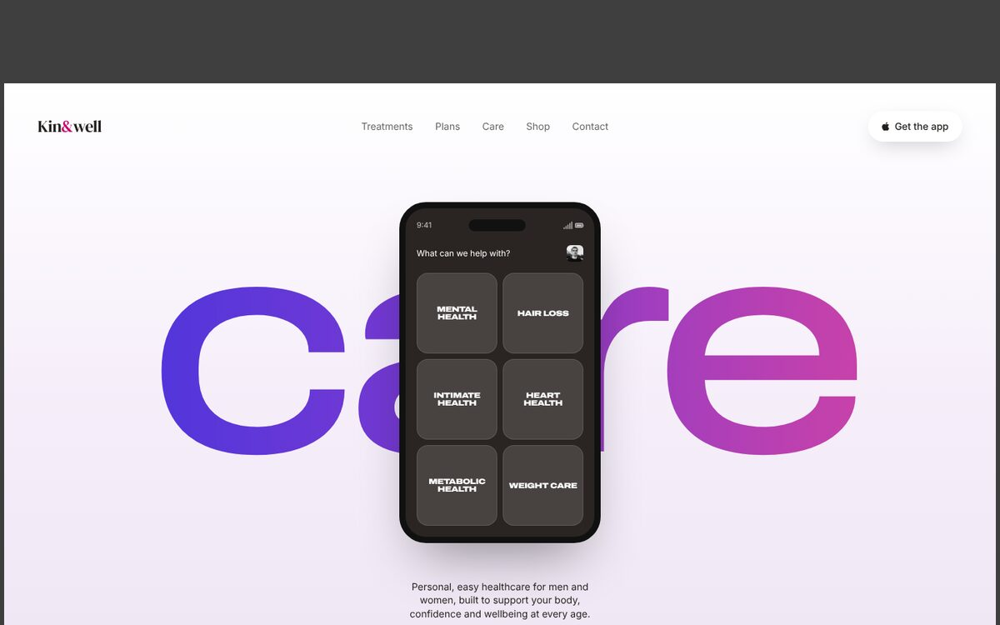</a><br><b>Kinwell</b> · Health &amp; Fitness<br>
<a href="https://letstemplates.com/templates/tailwind/health-fitness/kinwell/demo?utm_campaign=free-templates&amp;utm_content=kinwell&amp;utm_medium=readme&amp;utm_source=github">Live demo</a> · <a href="templates/kinwell">Code</a> · <a href="https://letstemplates.com/templates/health-fitness/kinwell?utm_campaign=free-templates&amp;utm_content=kinwell&amp;utm_medium=readme&amp;utm_source=github">Bootstrap, DaisyUI and Material Design versions</a>
</td>
<td width="50%" valign="top">
<a href="https://letstemplates.com/templates/tailwind/business/zendesign/demo?utm_campaign=free-templates&amp;utm_content=zendesign&amp;utm_medium=readme&amp;utm_source=github">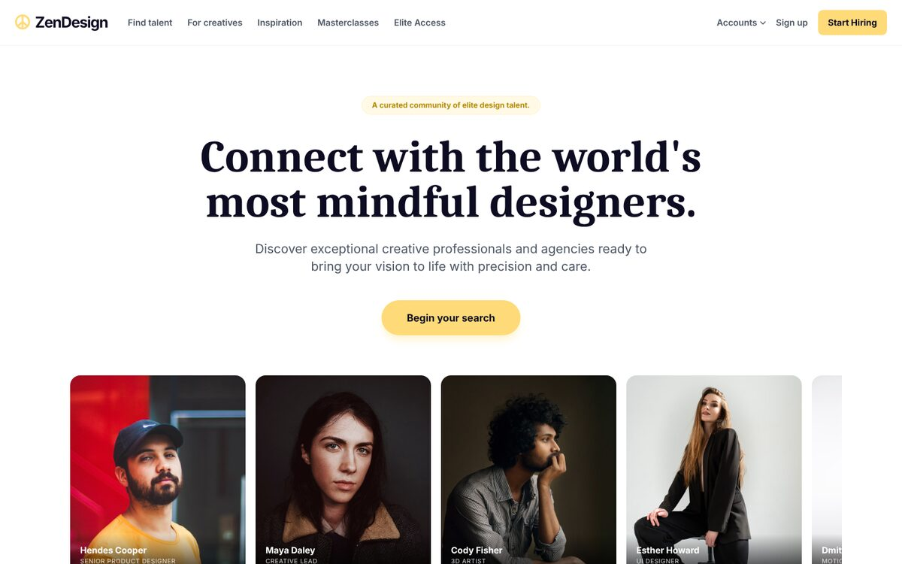</a><br><b>ZenDesign</b> · Business<br>
<a href="https://letstemplates.com/templates/tailwind/business/zendesign/demo?utm_campaign=free-templates&amp;utm_content=zendesign&amp;utm_medium=readme&amp;utm_source=github">Live demo</a> · <a href="templates/zendesign">Code</a> · <a href="https://letstemplates.com/templates/business/zendesign?utm_campaign=free-templates&amp;utm_content=zendesign&amp;utm_medium=readme&amp;utm_source=github">Bootstrap, DaisyUI and Material Design versions</a>
</td>
</tr>
<tr>
<td width="50%" valign="top">
<a href="https://letstemplates.com/templates/tailwind/saas/payengine/demo?utm_campaign=free-templates&amp;utm_content=payengine&amp;utm_medium=readme&amp;utm_source=github">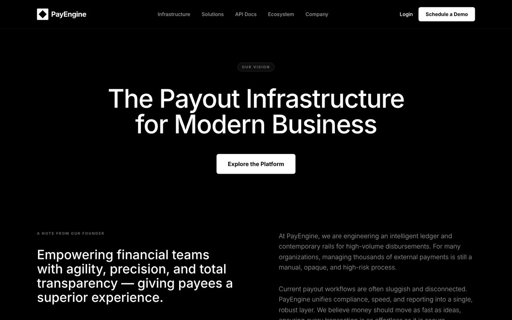</a><br><b>PayEngine</b> · SaaS<br>
<a href="https://letstemplates.com/templates/tailwind/saas/payengine/demo?utm_campaign=free-templates&amp;utm_content=payengine&amp;utm_medium=readme&amp;utm_source=github">Live demo</a> · <a href="templates/payengine">Code</a> · <a href="https://letstemplates.com/templates/saas/payengine?utm_campaign=free-templates&amp;utm_content=payengine&amp;utm_medium=readme&amp;utm_source=github">Bootstrap, DaisyUI and Material Design versions</a>
</td>
<td width="50%" valign="top">
<a href="https://letstemplates.com/templates/tailwind/travel/trailbound/demo?utm_campaign=free-templates&amp;utm_content=trailbound&amp;utm_medium=readme&amp;utm_source=github">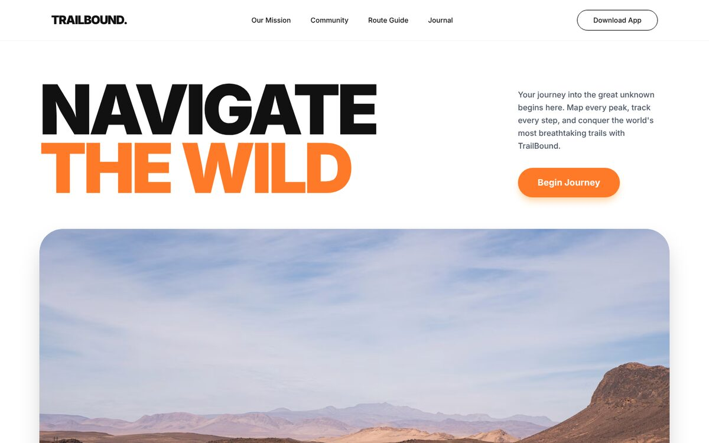</a><br><b>TrailBound</b> · Travel<br>
<a href="https://letstemplates.com/templates/tailwind/travel/trailbound/demo?utm_campaign=free-templates&amp;utm_content=trailbound&amp;utm_medium=readme&amp;utm_source=github">Live demo</a> · <a href="templates/trailbound">Code</a> · <a href="https://letstemplates.com/templates/travel/trailbound?utm_campaign=free-templates&amp;utm_content=trailbound&amp;utm_medium=readme&amp;utm_source=github">Bootstrap, DaisyUI and Material Design versions</a>
</td>
</tr>
<tr>
<td width="50%" valign="top">
<a href="https://letstemplates.com/templates/tailwind/education/brightpath-academy/demo?utm_campaign=free-templates&amp;utm_content=brightpath-academy&amp;utm_medium=readme&amp;utm_source=github">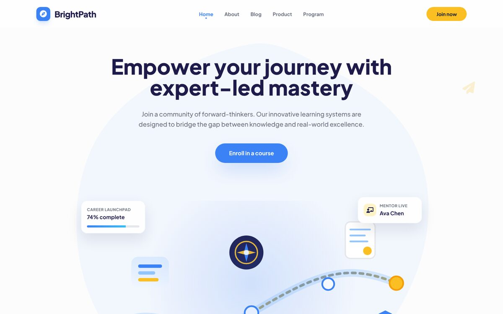</a><br><b>BrightPath Academy</b> · Education<br>
<a href="https://letstemplates.com/templates/tailwind/education/brightpath-academy/demo?utm_campaign=free-templates&amp;utm_content=brightpath-academy&amp;utm_medium=readme&amp;utm_source=github">Live demo</a> · <a href="templates/brightpath-academy">Code</a> · <a href="https://letstemplates.com/templates/education/brightpath-academy?utm_campaign=free-templates&amp;utm_content=brightpath-academy&amp;utm_medium=readme&amp;utm_source=github">Bootstrap, DaisyUI and Material Design versions</a>
</td>
<td width="50%" valign="top">
<a href="https://letstemplates.com/templates/tailwind/ecommerce/econest/demo?utm_campaign=free-templates&amp;utm_content=econest&amp;utm_medium=readme&amp;utm_source=github">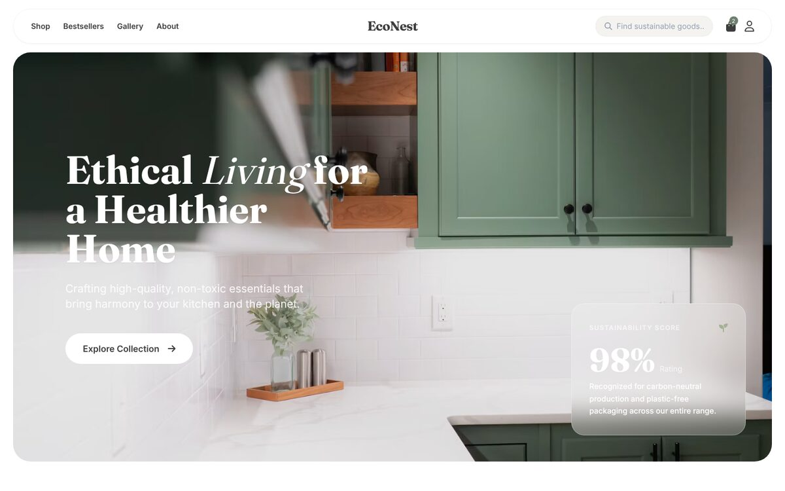</a><br><b>EcoNest</b> · E-commerce<br>
<a href="https://letstemplates.com/templates/tailwind/ecommerce/econest/demo?utm_campaign=free-templates&amp;utm_content=econest&amp;utm_medium=readme&amp;utm_source=github">Live demo</a> · <a href="templates/econest">Code</a> · <a href="https://letstemplates.com/templates/ecommerce/econest?utm_campaign=free-templates&amp;utm_content=econest&amp;utm_medium=readme&amp;utm_source=github">Bootstrap, DaisyUI and Material Design versions</a>
</td>
</tr>
<tr>
<td width="50%" valign="top">
<a href="https://letstemplates.com/templates/tailwind/business/the-fairway-club/demo?utm_campaign=free-templates&amp;utm_content=the-fairway-club&amp;utm_medium=readme&amp;utm_source=github">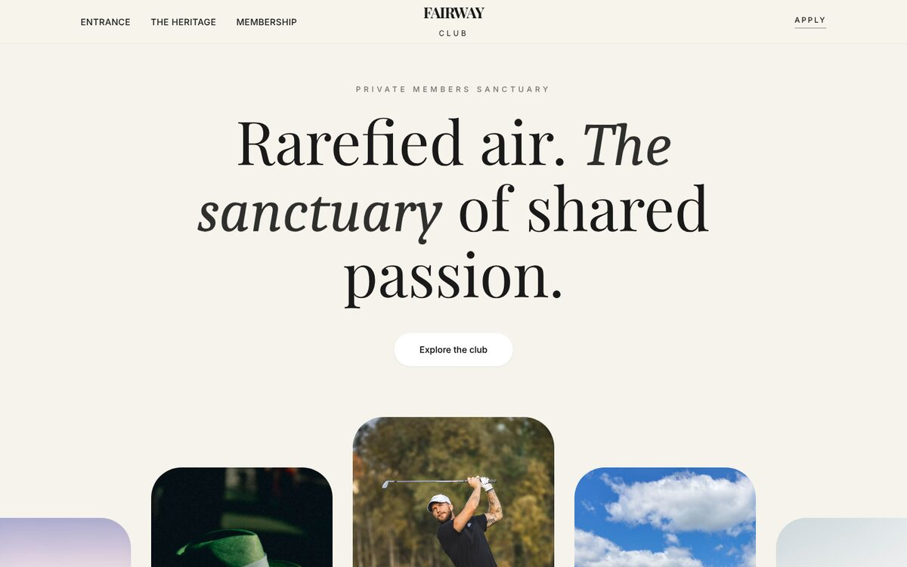</a><br><b>The Fairway Club</b> · Business<br>
<a href="https://letstemplates.com/templates/tailwind/business/the-fairway-club/demo?utm_campaign=free-templates&amp;utm_content=the-fairway-club&amp;utm_medium=readme&amp;utm_source=github">Live demo</a> · <a href="templates/the-fairway-club">Code</a> · <a href="https://letstemplates.com/templates/business/the-fairway-club?utm_campaign=free-templates&amp;utm_content=the-fairway-club&amp;utm_medium=readme&amp;utm_source=github">Bootstrap, DaisyUI and Material Design versions</a>
</td>
<td width="50%" valign="top">
<a href="https://letstemplates.com/templates/tailwind/saas/estateflow/demo?utm_campaign=free-templates&amp;utm_content=estateflow&amp;utm_medium=readme&amp;utm_source=github">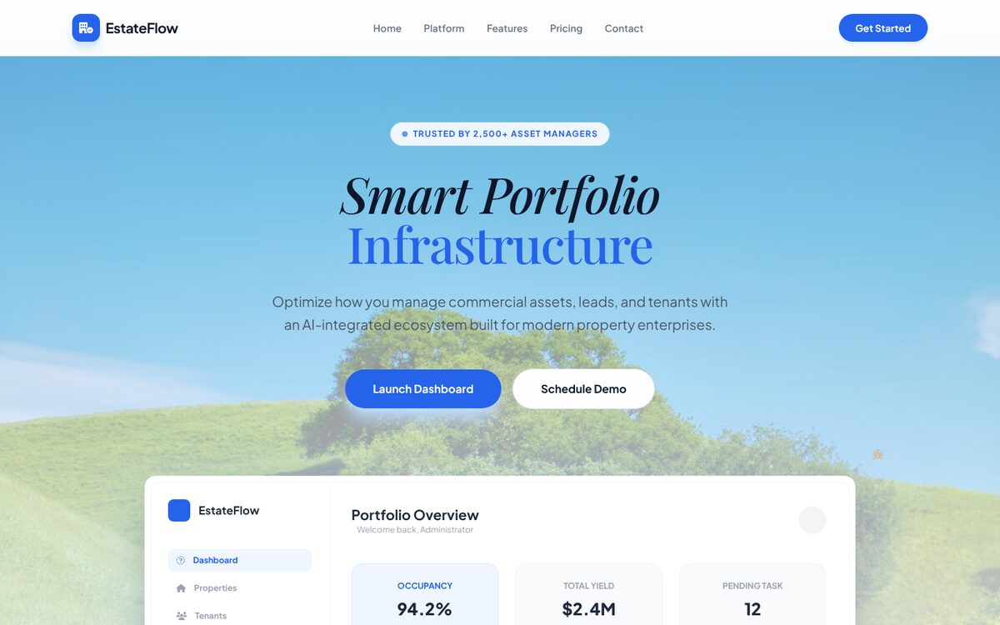</a><br><b>EstateFlow</b> · SaaS<br>
<a href="https://letstemplates.com/templates/tailwind/saas/estateflow/demo?utm_campaign=free-templates&amp;utm_content=estateflow&amp;utm_medium=readme&amp;utm_source=github">Live demo</a> · <a href="templates/estateflow">Code</a> · <a href="https://letstemplates.com/templates/saas/estateflow?utm_campaign=free-templates&amp;utm_content=estateflow&amp;utm_medium=readme&amp;utm_source=github">Bootstrap, DaisyUI and Material Design versions</a>
</td>
</tr>
<tr>
<td width="50%" valign="top">
<a href="https://letstemplates.com/templates/tailwind/saas/ignitionlab/demo?utm_campaign=free-templates&amp;utm_content=ignitionlab&amp;utm_medium=readme&amp;utm_source=github">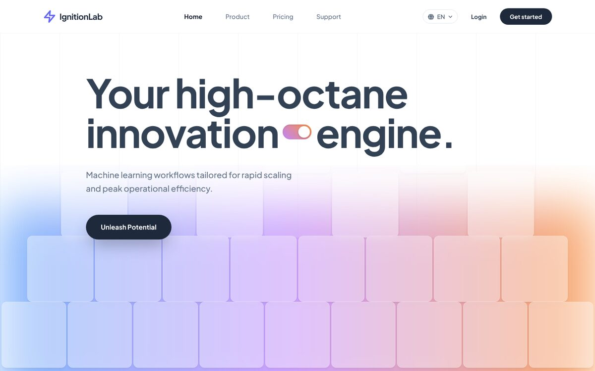</a><br><b>IgnitionLab</b> · SaaS<br>
<a href="https://letstemplates.com/templates/tailwind/saas/ignitionlab/demo?utm_campaign=free-templates&amp;utm_content=ignitionlab&amp;utm_medium=readme&amp;utm_source=github">Live demo</a> · <a href="templates/ignitionlab">Code</a> · <a href="https://letstemplates.com/templates/saas/ignitionlab?utm_campaign=free-templates&amp;utm_content=ignitionlab&amp;utm_medium=readme&amp;utm_source=github">Bootstrap, DaisyUI and Material Design versions</a>
</td>
<td width="50%" valign="top">
<a href="https://letstemplates.com/templates/tailwind/business/nutribite/demo?utm_campaign=free-templates&amp;utm_content=nutribite&amp;utm_medium=readme&amp;utm_source=github">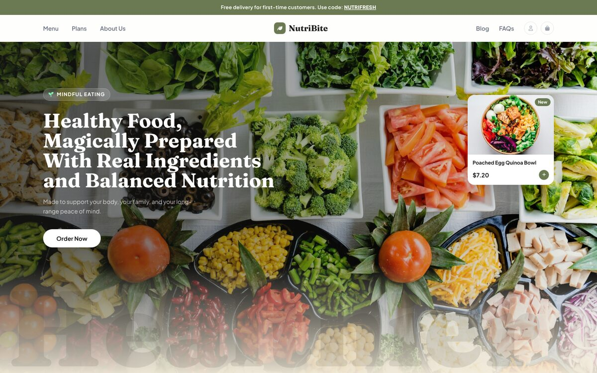</a><br><b>NutriBite</b> · Business<br>
<a href="https://letstemplates.com/templates/tailwind/business/nutribite/demo?utm_campaign=free-templates&amp;utm_content=nutribite&amp;utm_medium=readme&amp;utm_source=github">Live demo</a> · <a href="templates/nutribite">Code</a> · <a href="https://letstemplates.com/templates/business/nutribite?utm_campaign=free-templates&amp;utm_content=nutribite&amp;utm_medium=readme&amp;utm_source=github">Bootstrap, DaisyUI and Material Design versions</a>
</td>
</tr>
<tr>
<td width="50%" valign="top">
<a href="https://letstemplates.com/templates/tailwind/blog/journeymuse/demo?utm_campaign=free-templates&amp;utm_content=journeymuse&amp;utm_medium=readme&amp;utm_source=github">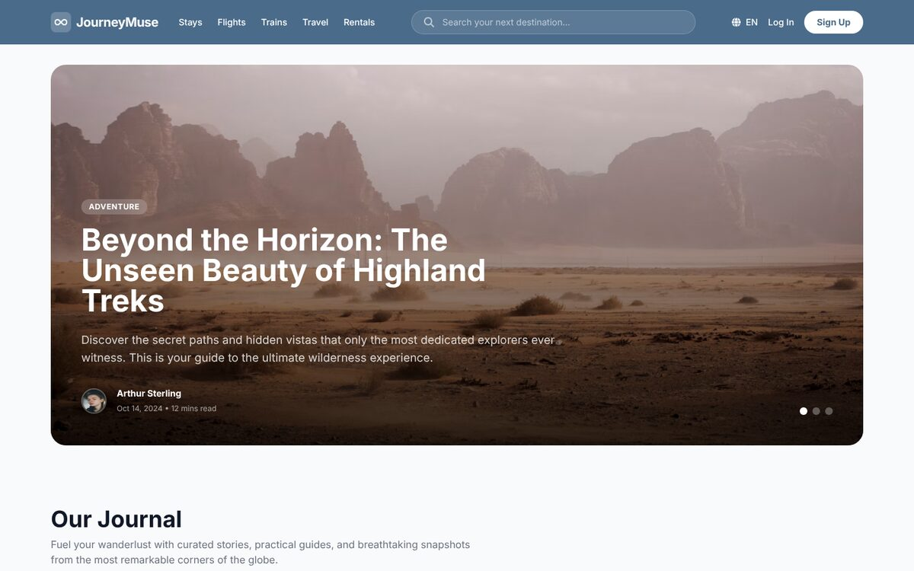</a><br><b>JourneyMuse</b> · Blog<br>
<a href="https://letstemplates.com/templates/tailwind/blog/journeymuse/demo?utm_campaign=free-templates&amp;utm_content=journeymuse&amp;utm_medium=readme&amp;utm_source=github">Live demo</a> · <a href="templates/journeymuse">Code</a> · <a href="https://letstemplates.com/templates/blog/journeymuse?utm_campaign=free-templates&amp;utm_content=journeymuse&amp;utm_medium=readme&amp;utm_source=github">Bootstrap, DaisyUI and Material Design versions</a>
</td>
<td width="50%" valign="top">
<a href="https://letstemplates.com/templates/tailwind/startup/nuvora/demo?utm_campaign=free-templates&amp;utm_content=nuvora&amp;utm_medium=readme&amp;utm_source=github">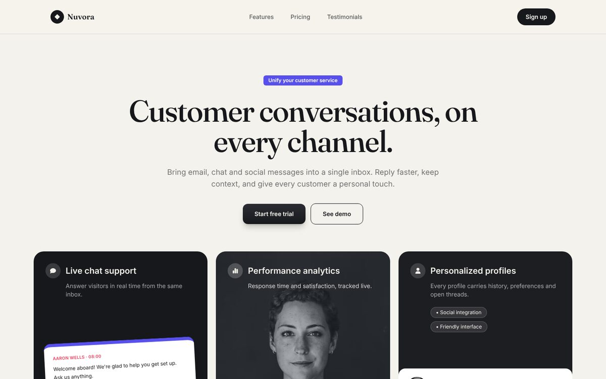</a><br><b>Nuvora</b> · Startup<br>
<a href="https://letstemplates.com/templates/tailwind/startup/nuvora/demo?utm_campaign=free-templates&amp;utm_content=nuvora&amp;utm_medium=readme&amp;utm_source=github">Live demo</a> · <a href="templates/nuvora">Code</a> · <a href="https://letstemplates.com/templates/startup/nuvora?utm_campaign=free-templates&amp;utm_content=nuvora&amp;utm_medium=readme&amp;utm_source=github">Bootstrap, DaisyUI and Material Design versions</a>
</td>
</tr>
<tr>
<td width="50%" valign="top">
<a href="https://letstemplates.com/templates/tailwind/ecommerce/oblique/demo?utm_campaign=free-templates&amp;utm_content=oblique&amp;utm_medium=readme&amp;utm_source=github">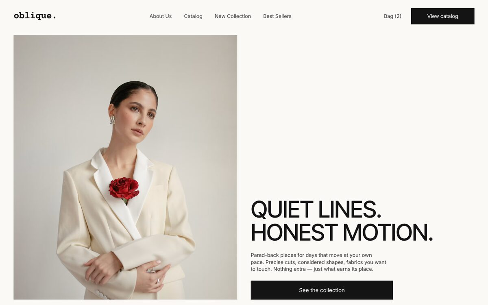</a><br><b>Oblique</b> · E-commerce<br>
<a href="https://letstemplates.com/templates/tailwind/ecommerce/oblique/demo?utm_campaign=free-templates&amp;utm_content=oblique&amp;utm_medium=readme&amp;utm_source=github">Live demo</a> · <a href="templates/oblique">Code</a> · <a href="https://letstemplates.com/templates/ecommerce/oblique?utm_campaign=free-templates&amp;utm_content=oblique&amp;utm_medium=readme&amp;utm_source=github">Bootstrap, DaisyUI and Material Design versions</a>
</td>
<td width="50%" valign="top">
<a href="https://letstemplates.com/templates/tailwind/agency/vireon/demo?utm_campaign=free-templates&amp;utm_content=vireon&amp;utm_medium=readme&amp;utm_source=github">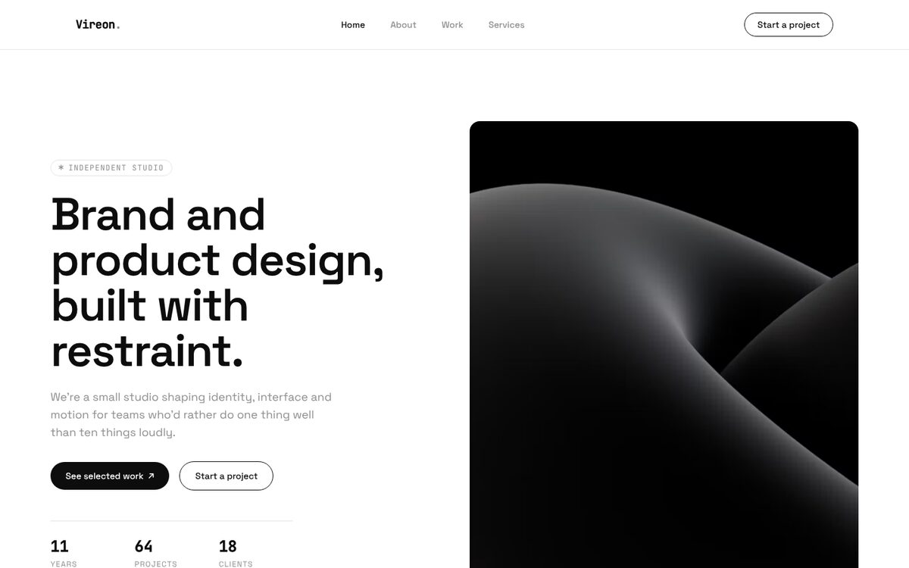</a><br><b>Vireon</b> · Agency<br>
<a href="https://letstemplates.com/templates/tailwind/agency/vireon/demo?utm_campaign=free-templates&amp;utm_content=vireon&amp;utm_medium=readme&amp;utm_source=github">Live demo</a> · <a href="templates/vireon">Code</a> · <a href="https://letstemplates.com/templates/agency/vireon?utm_campaign=free-templates&amp;utm_content=vireon&amp;utm_medium=readme&amp;utm_source=github">Bootstrap, DaisyUI and Material Design versions</a>
</td>
</tr>
<tr>
<td width="50%" valign="top">
<a href="https://letstemplates.com/templates/tailwind/food-restaurant/kaiyo-bistro/demo?utm_campaign=free-templates&amp;utm_content=kaiyo-bistro&amp;utm_medium=readme&amp;utm_source=github">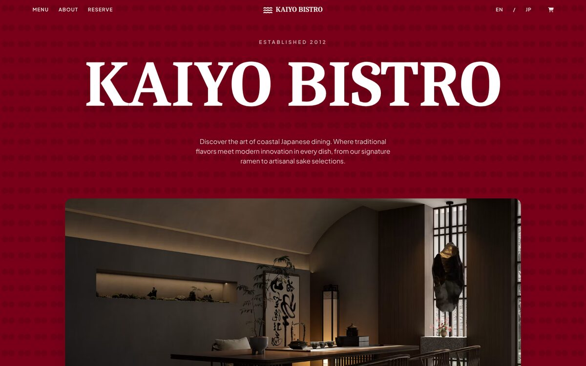</a><br><b>Kaiyo Bistro</b> · Food &amp; Restaurant<br>
<a href="https://letstemplates.com/templates/tailwind/food-restaurant/kaiyo-bistro/demo?utm_campaign=free-templates&amp;utm_content=kaiyo-bistro&amp;utm_medium=readme&amp;utm_source=github">Live demo</a> · <a href="templates/kaiyo-bistro">Code</a> · <a href="https://letstemplates.com/templates/food-restaurant/kaiyo-bistro?utm_campaign=free-templates&amp;utm_content=kaiyo-bistro&amp;utm_medium=readme&amp;utm_source=github">Bootstrap, DaisyUI and Material Design versions</a>
</td>
<td width="50%" valign="top">
<a href="https://letstemplates.com/templates/tailwind/blog/lumina/demo?utm_campaign=free-templates&amp;utm_content=lumina&amp;utm_medium=readme&amp;utm_source=github">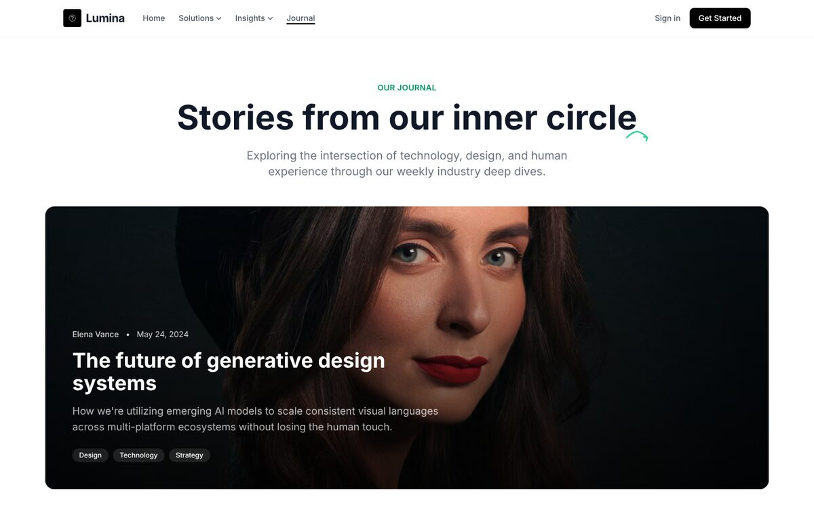</a><br><b>Lumina</b> · Blog<br>
<a href="https://letstemplates.com/templates/tailwind/blog/lumina/demo?utm_campaign=free-templates&amp;utm_content=lumina&amp;utm_medium=readme&amp;utm_source=github">Live demo</a> · <a href="templates/lumina">Code</a> · <a href="https://letstemplates.com/templates/blog/lumina?utm_campaign=free-templates&amp;utm_content=lumina&amp;utm_medium=readme&amp;utm_source=github">Bootstrap, DaisyUI and Material Design versions</a>
</td>
</tr>
<tr>
<td width="50%" valign="top">
<a href="https://letstemplates.com/templates/tailwind/agency/sproutline/demo?utm_campaign=free-templates&amp;utm_content=sproutline&amp;utm_medium=readme&amp;utm_source=github">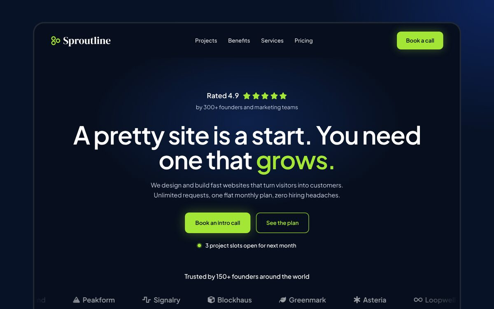</a><br><b>Sproutline</b> · Agency<br>
<a href="https://letstemplates.com/templates/tailwind/agency/sproutline/demo?utm_campaign=free-templates&amp;utm_content=sproutline&amp;utm_medium=readme&amp;utm_source=github">Live demo</a> · <a href="templates/sproutline">Code</a> · <a href="https://letstemplates.com/templates/agency/sproutline?utm_campaign=free-templates&amp;utm_content=sproutline&amp;utm_medium=readme&amp;utm_source=github">Bootstrap, DaisyUI and Material Design versions</a>
</td>
<td width="50%" valign="top">
<a href="https://letstemplates.com/templates/tailwind/startup/wayloom/demo?utm_campaign=free-templates&amp;utm_content=wayloom&amp;utm_medium=readme&amp;utm_source=github">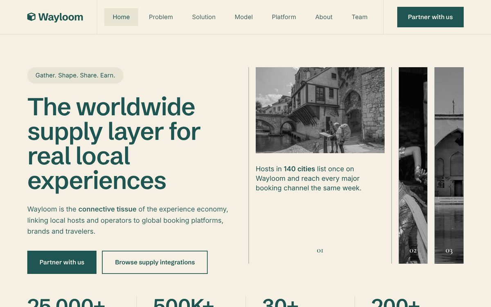</a><br><b>Wayloom</b> · Startup<br>
<a href="https://letstemplates.com/templates/tailwind/startup/wayloom/demo?utm_campaign=free-templates&amp;utm_content=wayloom&amp;utm_medium=readme&amp;utm_source=github">Live demo</a> · <a href="templates/wayloom">Code</a> · <a href="https://letstemplates.com/templates/startup/wayloom?utm_campaign=free-templates&amp;utm_content=wayloom&amp;utm_medium=readme&amp;utm_source=github">Bootstrap, DaisyUI and Material Design versions</a>
</td>
</tr>
<tr>
<td width="50%" valign="top">
<a href="https://letstemplates.com/templates/tailwind/business/kindhire/demo?utm_campaign=free-templates&amp;utm_content=kindhire&amp;utm_medium=readme&amp;utm_source=github"></a><br><b>Kindhire</b> · Business<br>
<a href="https://letstemplates.com/templates/tailwind/business/kindhire/demo?utm_campaign=free-templates&amp;utm_content=kindhire&amp;utm_medium=readme&amp;utm_source=github">Live demo</a> · <a href="templates/kindhire">Code</a> · <a href="https://letstemplates.com/templates/business/kindhire?utm_campaign=free-templates&amp;utm_content=kindhire&amp;utm_medium=readme&amp;utm_source=github">Bootstrap, DaisyUI and Material Design versions</a>
</td>
<td width="50%" valign="top">
<a href="https://letstemplates.com/templates/tailwind/health-fitness/oruna/demo?utm_campaign=free-templates&amp;utm_content=oruna&amp;utm_medium=readme&amp;utm_source=github">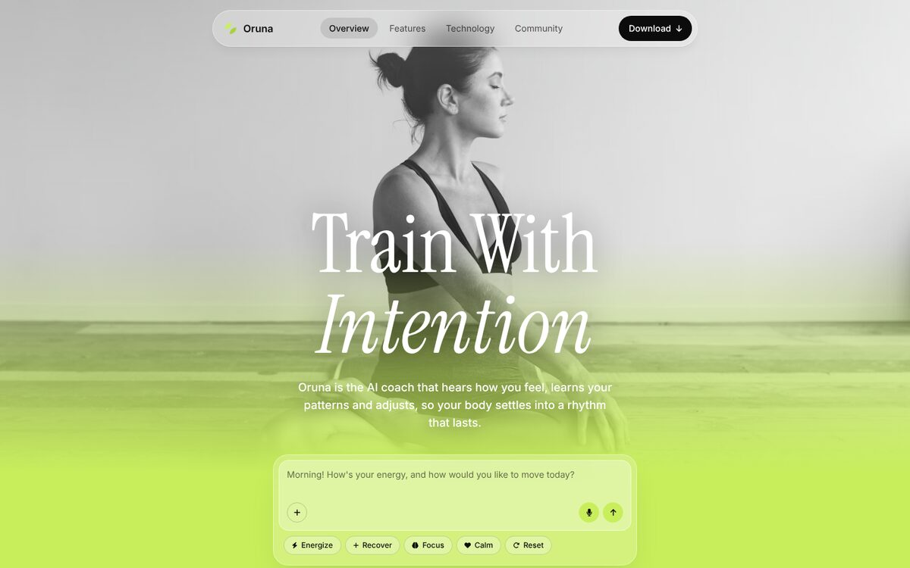</a><br><b>Oruna</b> · Health &amp; Fitness<br>
<a href="https://letstemplates.com/templates/tailwind/health-fitness/oruna/demo?utm_campaign=free-templates&amp;utm_content=oruna&amp;utm_medium=readme&amp;utm_source=github">Live demo</a> · <a href="templates/oruna">Code</a> · <a href="https://letstemplates.com/templates/health-fitness/oruna?utm_campaign=free-templates&amp;utm_content=oruna&amp;utm_medium=readme&amp;utm_source=github">Bootstrap, DaisyUI and Material Design versions</a>
</td>
</tr>
<tr>
<td width="50%" valign="top">
<a href="https://letstemplates.com/templates/tailwind/consulting/keelson/demo?utm_campaign=free-templates&amp;utm_content=keelson&amp;utm_medium=readme&amp;utm_source=github">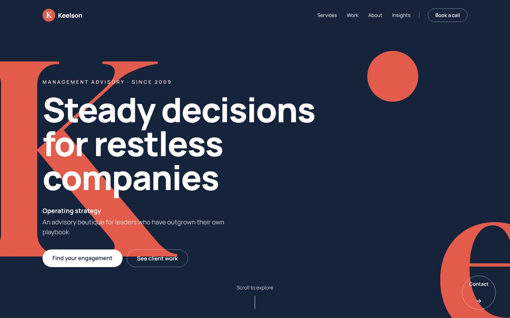</a><br><b>Keelson</b> · Professional Services<br>
<a href="https://letstemplates.com/templates/tailwind/consulting/keelson/demo?utm_campaign=free-templates&amp;utm_content=keelson&amp;utm_medium=readme&amp;utm_source=github">Live demo</a> · <a href="templates/keelson">Code</a> · <a href="https://letstemplates.com/templates/consulting/keelson?utm_campaign=free-templates&amp;utm_content=keelson&amp;utm_medium=readme&amp;utm_source=github">Bootstrap, DaisyUI and Material Design versions</a>
</td>
<td width="50%" valign="top">
<a href="https://letstemplates.com/templates/tailwind/agency/velmora/demo?utm_campaign=free-templates&amp;utm_content=velmora&amp;utm_medium=readme&amp;utm_source=github"></a><br><b>Velmora</b> · Agency<br>
<a href="https://letstemplates.com/templates/tailwind/agency/velmora/demo?utm_campaign=free-templates&amp;utm_content=velmora&amp;utm_medium=readme&amp;utm_source=github">Live demo</a> · <a href="templates/velmora">Code</a> · <a href="https://letstemplates.com/templates/agency/velmora?utm_campaign=free-templates&amp;utm_content=velmora&amp;utm_medium=readme&amp;utm_source=github">Bootstrap, DaisyUI and Material Design versions</a>
</td>
</tr>
<tr>
<td width="50%" valign="top">
<a href="https://letstemplates.com/templates/tailwind/business/tressa/demo?utm_campaign=free-templates&amp;utm_content=tressa&amp;utm_medium=readme&amp;utm_source=github">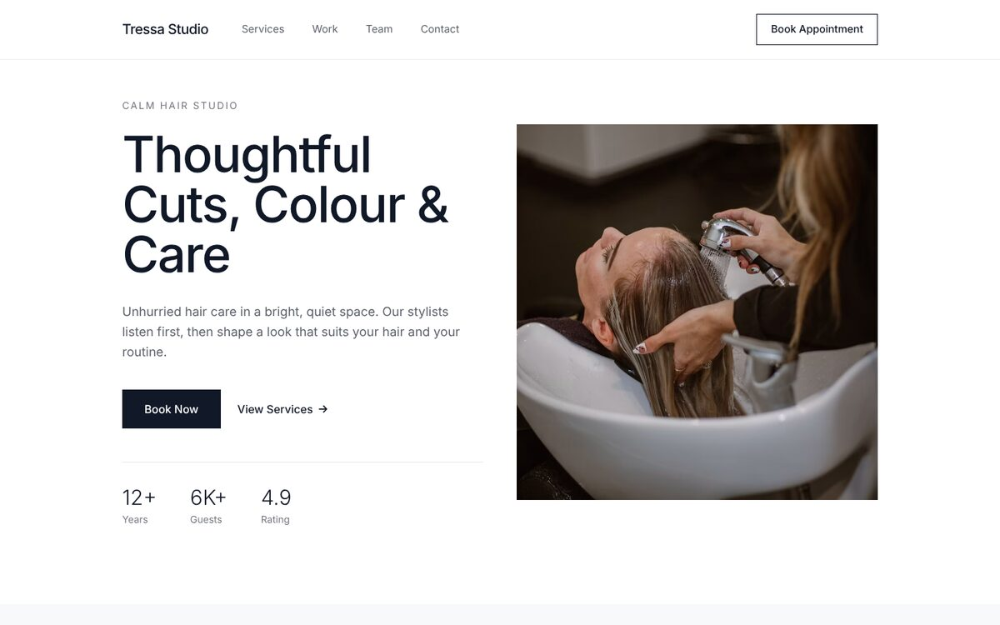</a><br><b>Tressa</b> · Business<br>
<a href="https://letstemplates.com/templates/tailwind/business/tressa/demo?utm_campaign=free-templates&amp;utm_content=tressa&amp;utm_medium=readme&amp;utm_source=github">Live demo</a> · <a href="templates/tressa">Code</a> · <a href="https://letstemplates.com/templates/business/tressa?utm_campaign=free-templates&amp;utm_content=tressa&amp;utm_medium=readme&amp;utm_source=github">Bootstrap, DaisyUI and Material Design versions</a>
</td>
<td width="50%" valign="top">
<a href="https://letstemplates.com/templates/tailwind/portfolio/emberlyn/demo?utm_campaign=free-templates&amp;utm_content=emberlyn&amp;utm_medium=readme&amp;utm_source=github"></a><br><b>Emberlyn</b> · Portfolio<br>
<a href="https://letstemplates.com/templates/tailwind/portfolio/emberlyn/demo?utm_campaign=free-templates&amp;utm_content=emberlyn&amp;utm_medium=readme&amp;utm_source=github">Live demo</a> · <a href="templates/emberlyn">Code</a> · <a href="https://letstemplates.com/templates/portfolio/emberlyn?utm_campaign=free-templates&amp;utm_content=emberlyn&amp;utm_medium=readme&amp;utm_source=github">Bootstrap, DaisyUI and Material Design versions</a>
</td>
</tr>
<tr>
<td width="50%" valign="top">
<a href="https://letstemplates.com/templates/tailwind/agency/velvoro/demo?utm_campaign=free-templates&amp;utm_content=velvoro&amp;utm_medium=readme&amp;utm_source=github">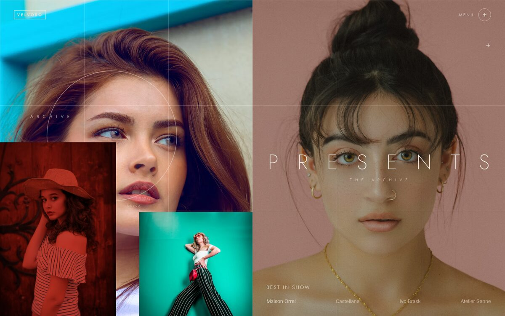</a><br><b>Velvoro</b> · Agency<br>
<a href="https://letstemplates.com/templates/tailwind/agency/velvoro/demo?utm_campaign=free-templates&amp;utm_content=velvoro&amp;utm_medium=readme&amp;utm_source=github">Live demo</a> · <a href="templates/velvoro">Code</a> · <a href="https://letstemplates.com/templates/agency/velvoro?utm_campaign=free-templates&amp;utm_content=velvoro&amp;utm_medium=readme&amp;utm_source=github">Bootstrap, DaisyUI and Material Design versions</a>
</td>
<td width="50%" valign="top">
<a href="https://letstemplates.com/templates/tailwind/fintech/fernwise/demo?utm_campaign=free-templates&amp;utm_content=fernwise&amp;utm_medium=readme&amp;utm_source=github">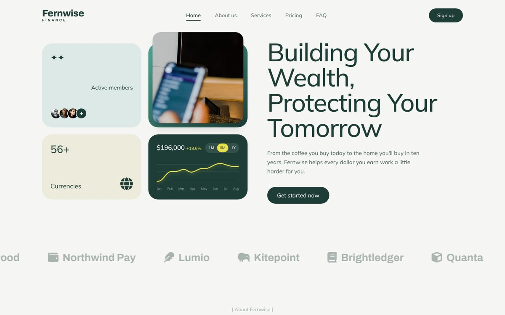</a><br><b>Fernwise</b> · Finance &amp; Fintech<br>
<a href="https://letstemplates.com/templates/tailwind/fintech/fernwise/demo?utm_campaign=free-templates&amp;utm_content=fernwise&amp;utm_medium=readme&amp;utm_source=github">Live demo</a> · <a href="templates/fernwise">Code</a> · <a href="https://letstemplates.com/templates/fintech/fernwise?utm_campaign=free-templates&amp;utm_content=fernwise&amp;utm_medium=readme&amp;utm_source=github">Bootstrap, DaisyUI and Material Design versions</a>
</td>
</tr>
<tr>
<td width="50%" valign="top">
<a href="https://letstemplates.com/templates/tailwind/consulting/kinetiq/demo?utm_campaign=free-templates&amp;utm_content=kinetiq&amp;utm_medium=readme&amp;utm_source=github">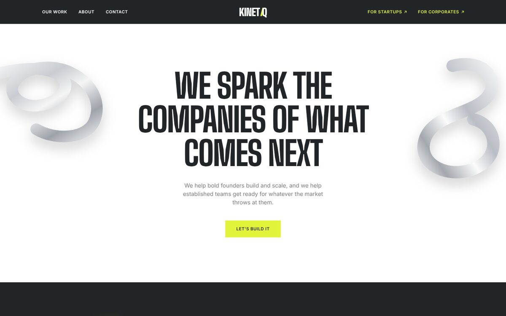</a><br><b>Kinetiq</b> · Professional Services<br>
<a href="https://letstemplates.com/templates/tailwind/consulting/kinetiq/demo?utm_campaign=free-templates&amp;utm_content=kinetiq&amp;utm_medium=readme&amp;utm_source=github">Live demo</a> · <a href="templates/kinetiq">Code</a> · <a href="https://letstemplates.com/templates/consulting/kinetiq?utm_campaign=free-templates&amp;utm_content=kinetiq&amp;utm_medium=readme&amp;utm_source=github">Bootstrap, DaisyUI and Material Design versions</a>
</td>
<td width="50%" valign="top">
<a href="https://letstemplates.com/templates/tailwind/business/brassmoor/demo?utm_campaign=free-templates&amp;utm_content=brassmoor&amp;utm_medium=readme&amp;utm_source=github">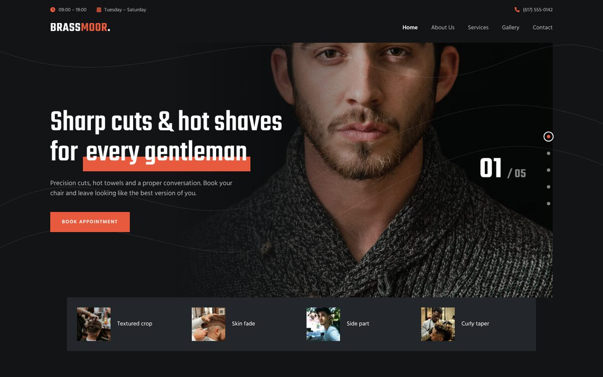</a><br><b>Brassmoor</b> · Business<br>
<a href="https://letstemplates.com/templates/tailwind/business/brassmoor/demo?utm_campaign=free-templates&amp;utm_content=brassmoor&amp;utm_medium=readme&amp;utm_source=github">Live demo</a> · <a href="templates/brassmoor">Code</a> · <a href="https://letstemplates.com/templates/business/brassmoor?utm_campaign=free-templates&amp;utm_content=brassmoor&amp;utm_medium=readme&amp;utm_source=github">Bootstrap, DaisyUI and Material Design versions</a>
</td>
</tr>
<tr>
<td width="50%" valign="top">
<a href="https://letstemplates.com/templates/tailwind/health-fitness/corevia/demo?utm_campaign=free-templates&amp;utm_content=corevia&amp;utm_medium=readme&amp;utm_source=github">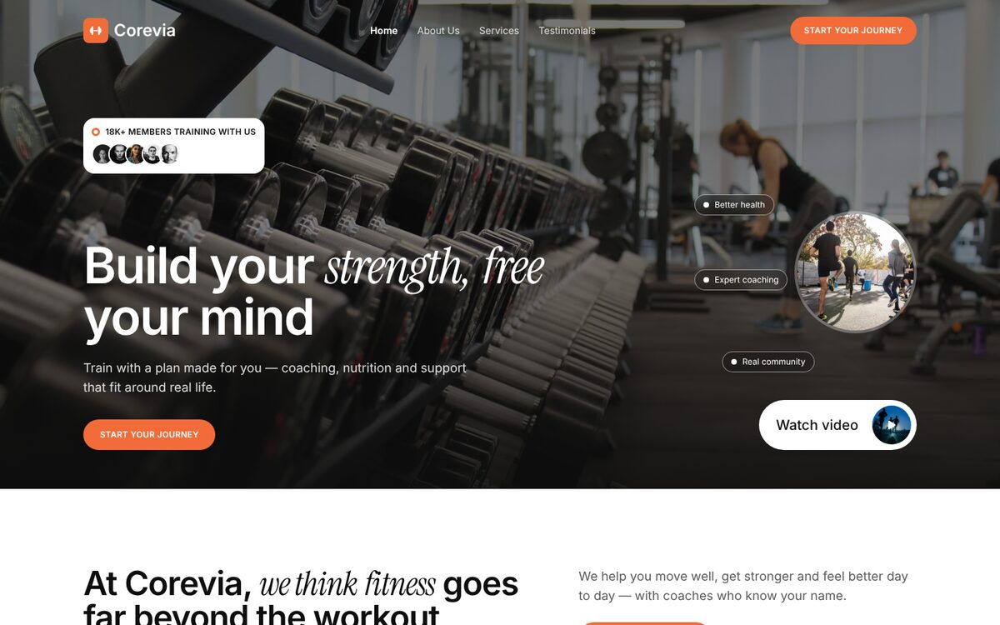</a><br><b>Corevia</b> · Health &amp; Fitness<br>
<a href="https://letstemplates.com/templates/tailwind/health-fitness/corevia/demo?utm_campaign=free-templates&amp;utm_content=corevia&amp;utm_medium=readme&amp;utm_source=github">Live demo</a> · <a href="templates/corevia">Code</a> · <a href="https://letstemplates.com/templates/health-fitness/corevia?utm_campaign=free-templates&amp;utm_content=corevia&amp;utm_medium=readme&amp;utm_source=github">Bootstrap, DaisyUI and Material Design versions</a>
</td>
<td width="50%" valign="top">
<a href="https://letstemplates.com/templates/tailwind/health-fitness/strivo/demo?utm_campaign=free-templates&amp;utm_content=strivo&amp;utm_medium=readme&amp;utm_source=github">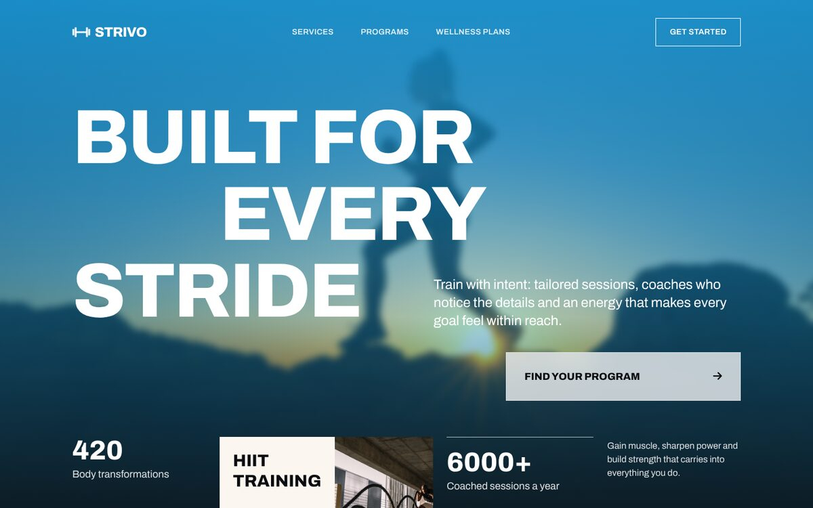</a><br><b>Strivo</b> · Health &amp; Fitness<br>
<a href="https://letstemplates.com/templates/tailwind/health-fitness/strivo/demo?utm_campaign=free-templates&amp;utm_content=strivo&amp;utm_medium=readme&amp;utm_source=github">Live demo</a> · <a href="templates/strivo">Code</a> · <a href="https://letstemplates.com/templates/health-fitness/strivo?utm_campaign=free-templates&amp;utm_content=strivo&amp;utm_medium=readme&amp;utm_source=github">Bootstrap, DaisyUI and Material Design versions</a>
</td>
</tr>
<tr>
<td width="50%" valign="top">
<a href="https://letstemplates.com/templates/tailwind/blog/ascendia/demo?utm_campaign=free-templates&amp;utm_content=ascendia&amp;utm_medium=readme&amp;utm_source=github"></a><br><b>Ascendia</b> · Blog<br>
<a href="https://letstemplates.com/templates/tailwind/blog/ascendia/demo?utm_campaign=free-templates&amp;utm_content=ascendia&amp;utm_medium=readme&amp;utm_source=github">Live demo</a> · <a href="templates/ascendia">Code</a> · <a href="https://letstemplates.com/templates/blog/ascendia?utm_campaign=free-templates&amp;utm_content=ascendia&amp;utm_medium=readme&amp;utm_source=github">Bootstrap, DaisyUI and Material Design versions</a>
</td>
<td width="50%" valign="top">
<a href="https://letstemplates.com/templates/tailwind/health-fitness/aeris/demo?utm_campaign=free-templates&amp;utm_content=aeris&amp;utm_medium=readme&amp;utm_source=github">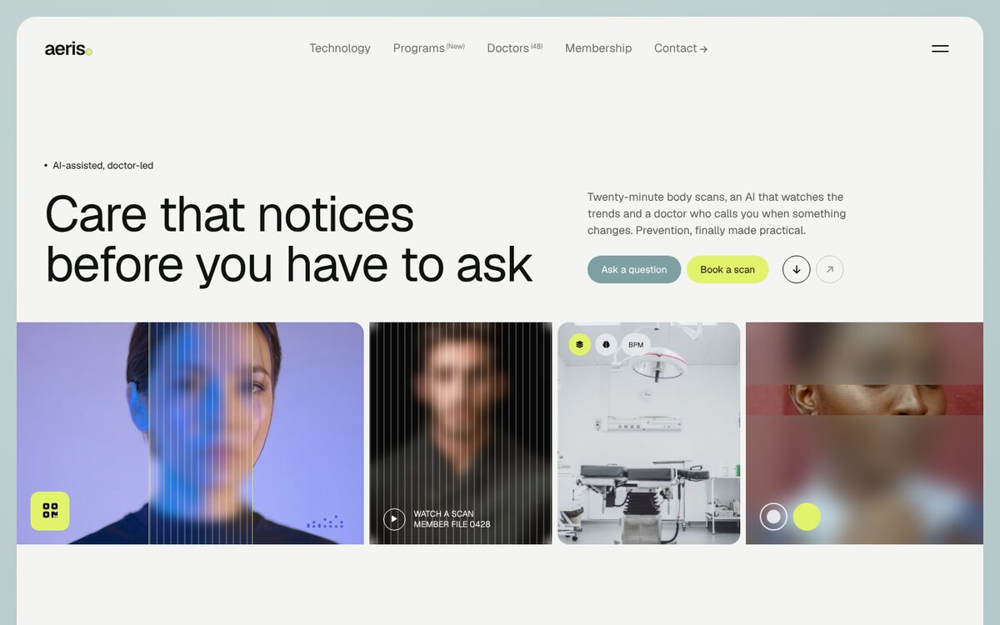</a><br><b>Aeris</b> · Health &amp; Fitness<br>
<a href="https://letstemplates.com/templates/tailwind/health-fitness/aeris/demo?utm_campaign=free-templates&amp;utm_content=aeris&amp;utm_medium=readme&amp;utm_source=github">Live demo</a> · <a href="templates/aeris">Code</a> · <a href="https://letstemplates.com/templates/health-fitness/aeris?utm_campaign=free-templates&amp;utm_content=aeris&amp;utm_medium=readme&amp;utm_source=github">Bootstrap, DaisyUI and Material Design versions</a>
</td>
</tr>
<tr>
<td width="50%" valign="top">
<a href="https://letstemplates.com/templates/tailwind/education/kernfield/demo?utm_campaign=free-templates&amp;utm_content=kernfield&amp;utm_medium=readme&amp;utm_source=github">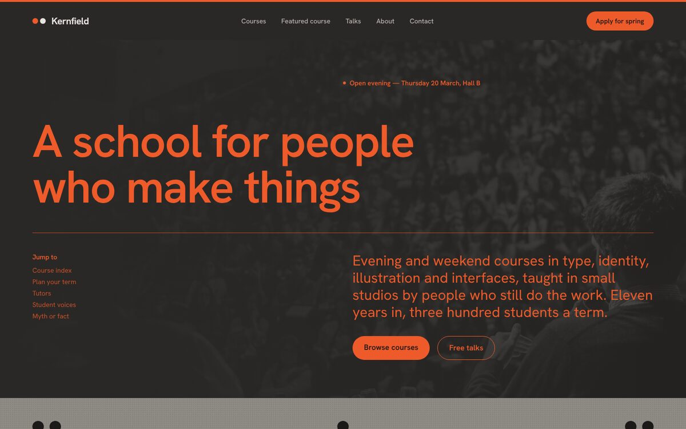</a><br><b>Kernfield</b> · Education<br>
<a href="https://letstemplates.com/templates/tailwind/education/kernfield/demo?utm_campaign=free-templates&amp;utm_content=kernfield&amp;utm_medium=readme&amp;utm_source=github">Live demo</a> · <a href="templates/kernfield">Code</a> · <a href="https://letstemplates.com/templates/education/kernfield?utm_campaign=free-templates&amp;utm_content=kernfield&amp;utm_medium=readme&amp;utm_source=github">Bootstrap, DaisyUI and Material Design versions</a>
</td>
<td width="50%" valign="top">
<a href="https://letstemplates.com/templates/tailwind/portfolio/kontur/demo?utm_campaign=free-templates&amp;utm_content=kontur&amp;utm_medium=readme&amp;utm_source=github"></a><br><b>Kontur</b> · Portfolio<br>
<a href="https://letstemplates.com/templates/tailwind/portfolio/kontur/demo?utm_campaign=free-templates&amp;utm_content=kontur&amp;utm_medium=readme&amp;utm_source=github">Live demo</a> · <a href="templates/kontur">Code</a> · <a href="https://letstemplates.com/templates/portfolio/kontur?utm_campaign=free-templates&amp;utm_content=kontur&amp;utm_medium=readme&amp;utm_source=github">Bootstrap, DaisyUI and Material Design versions</a>
</td>
</tr>
<tr>
<td width="50%" valign="top">
<a href="https://letstemplates.com/templates/tailwind/health-fitness/velisse/demo?utm_campaign=free-templates&amp;utm_content=velisse&amp;utm_medium=readme&amp;utm_source=github">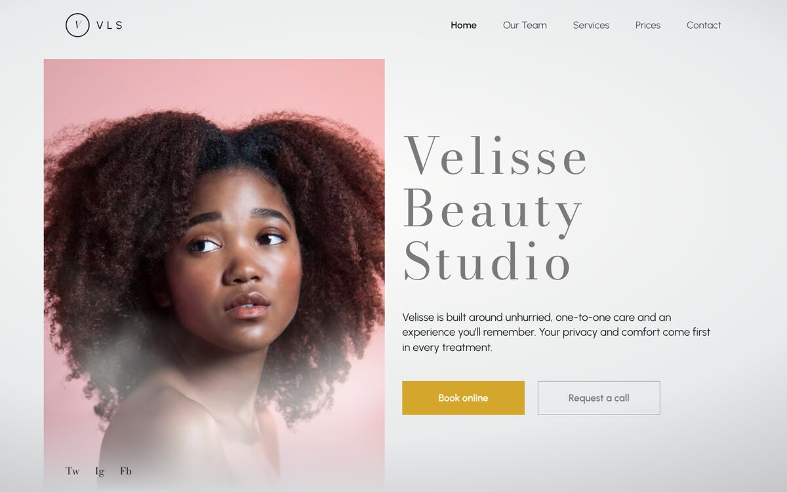</a><br><b>Velisse</b> · Health &amp; Fitness<br>
<a href="https://letstemplates.com/templates/tailwind/health-fitness/velisse/demo?utm_campaign=free-templates&amp;utm_content=velisse&amp;utm_medium=readme&amp;utm_source=github">Live demo</a> · <a href="templates/velisse">Code</a> · <a href="https://letstemplates.com/templates/health-fitness/velisse?utm_campaign=free-templates&amp;utm_content=velisse&amp;utm_medium=readme&amp;utm_source=github">Bootstrap, DaisyUI and Material Design versions</a>
</td>
<td width="50%" valign="top">
<a href="https://letstemplates.com/templates/tailwind/education/tenace/demo?utm_campaign=free-templates&amp;utm_content=tenace&amp;utm_medium=readme&amp;utm_source=github">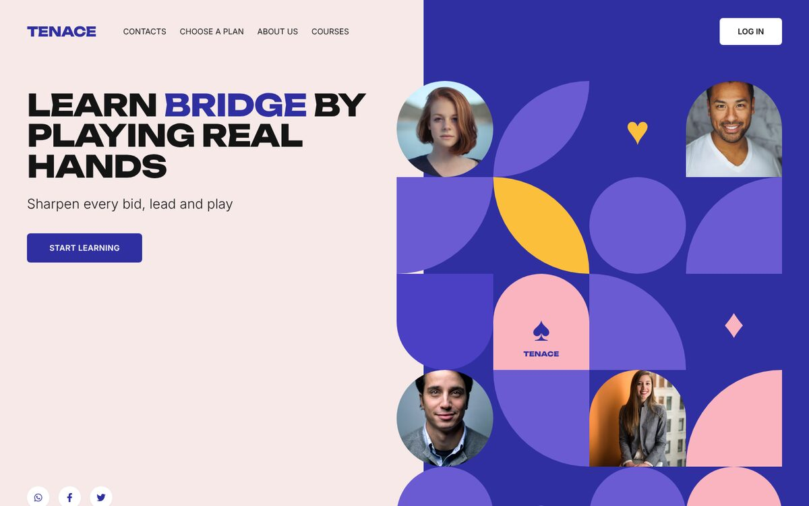</a><br><b>Tenace</b> · Education<br>
<a href="https://letstemplates.com/templates/tailwind/education/tenace/demo?utm_campaign=free-templates&amp;utm_content=tenace&amp;utm_medium=readme&amp;utm_source=github">Live demo</a> · <a href="templates/tenace">Code</a> · <a href="https://letstemplates.com/templates/education/tenace?utm_campaign=free-templates&amp;utm_content=tenace&amp;utm_medium=readme&amp;utm_source=github">Bootstrap, DaisyUI and Material Design versions</a>
</td>
</tr>
<tr>
<td width="50%" valign="top">
<a href="https://letstemplates.com/templates/tailwind/food-restaurant/crumbelle/demo?utm_campaign=free-templates&amp;utm_content=crumbelle&amp;utm_medium=readme&amp;utm_source=github">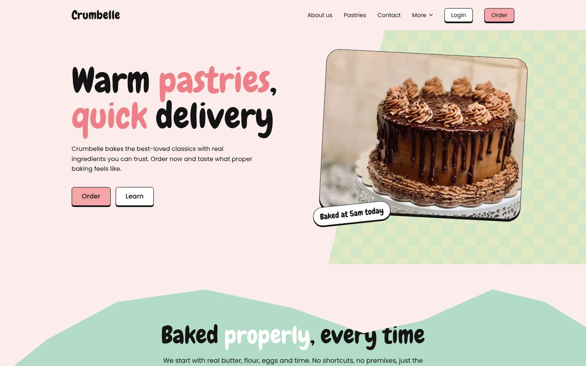</a><br><b>Crumbelle</b> · Food &amp; Restaurant<br>
<a href="https://letstemplates.com/templates/tailwind/food-restaurant/crumbelle/demo?utm_campaign=free-templates&amp;utm_content=crumbelle&amp;utm_medium=readme&amp;utm_source=github">Live demo</a> · <a href="templates/crumbelle">Code</a> · <a href="https://letstemplates.com/templates/food-restaurant/crumbelle?utm_campaign=free-templates&amp;utm_content=crumbelle&amp;utm_medium=readme&amp;utm_source=github">Bootstrap, DaisyUI and Material Design versions</a>
</td>
<td width="50%" valign="top">
<a href="https://letstemplates.com/templates/tailwind/ecommerce/saltmere/demo?utm_campaign=free-templates&amp;utm_content=saltmere&amp;utm_medium=readme&amp;utm_source=github">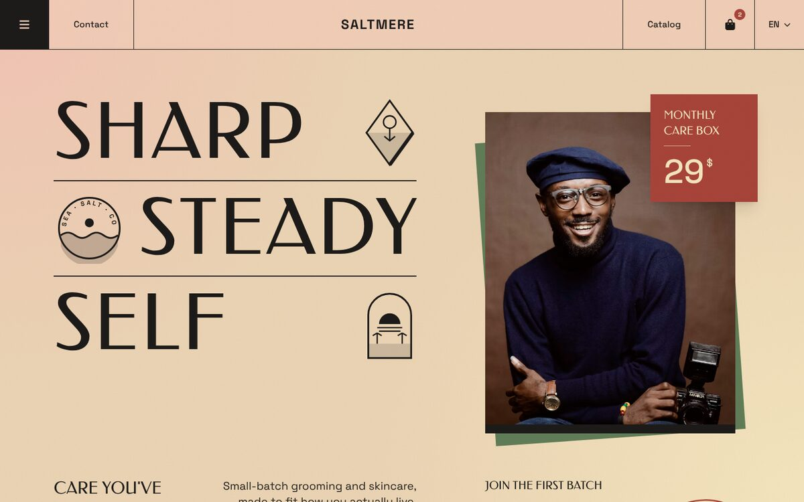</a><br><b>Saltmere</b> · E-commerce<br>
<a href="https://letstemplates.com/templates/tailwind/ecommerce/saltmere/demo?utm_campaign=free-templates&amp;utm_content=saltmere&amp;utm_medium=readme&amp;utm_source=github">Live demo</a> · <a href="templates/saltmere">Code</a> · <a href="https://letstemplates.com/templates/ecommerce/saltmere?utm_campaign=free-templates&amp;utm_content=saltmere&amp;utm_medium=readme&amp;utm_source=github">Bootstrap, DaisyUI and Material Design versions</a>
</td>
</tr>
<tr>
<td width="50%" valign="top">
<a href="https://letstemplates.com/templates/tailwind/blog/postwave/demo?utm_campaign=free-templates&amp;utm_content=postwave&amp;utm_medium=readme&amp;utm_source=github">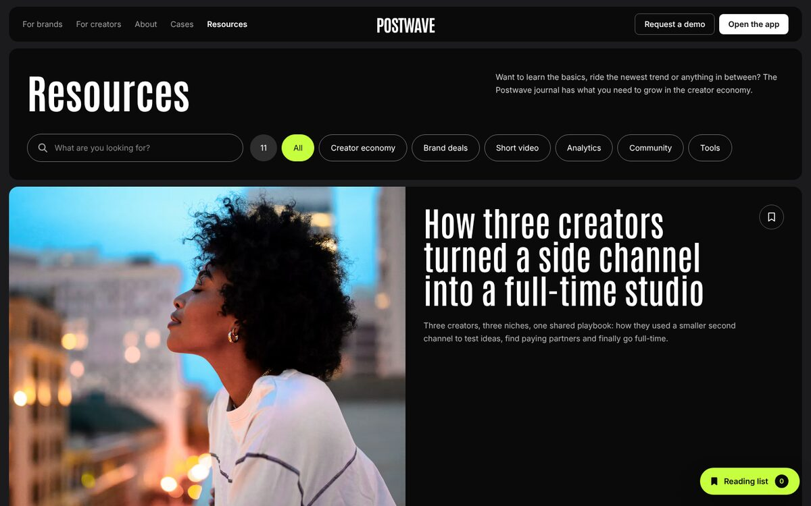</a><br><b>Postwave</b> · Blog<br>
<a href="https://letstemplates.com/templates/tailwind/blog/postwave/demo?utm_campaign=free-templates&amp;utm_content=postwave&amp;utm_medium=readme&amp;utm_source=github">Live demo</a> · <a href="templates/postwave">Code</a> · <a href="https://letstemplates.com/templates/blog/postwave?utm_campaign=free-templates&amp;utm_content=postwave&amp;utm_medium=readme&amp;utm_source=github">Bootstrap, DaisyUI and Material Design versions</a>
</td>
<td width="50%" valign="top">
<a href="https://letstemplates.com/templates/tailwind/health-fitness/trichora/demo?utm_campaign=free-templates&amp;utm_content=trichora&amp;utm_medium=readme&amp;utm_source=github">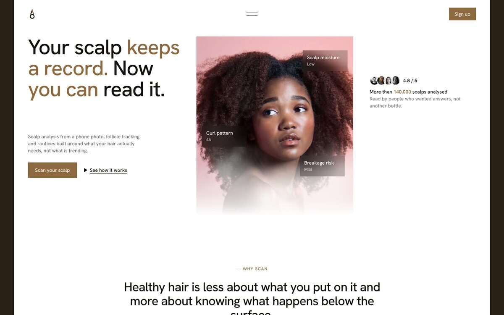</a><br><b>Trichora</b> · Health &amp; Fitness<br>
<a href="https://letstemplates.com/templates/tailwind/health-fitness/trichora/demo?utm_campaign=free-templates&amp;utm_content=trichora&amp;utm_medium=readme&amp;utm_source=github">Live demo</a> · <a href="templates/trichora">Code</a> · <a href="https://letstemplates.com/templates/health-fitness/trichora?utm_campaign=free-templates&amp;utm_content=trichora&amp;utm_medium=readme&amp;utm_source=github">Bootstrap, DaisyUI and Material Design versions</a>
</td>
</tr>
<tr>
<td width="50%" valign="top">
<a href="https://letstemplates.com/templates/tailwind/consulting/threefold/demo?utm_campaign=free-templates&amp;utm_content=threefold&amp;utm_medium=readme&amp;utm_source=github">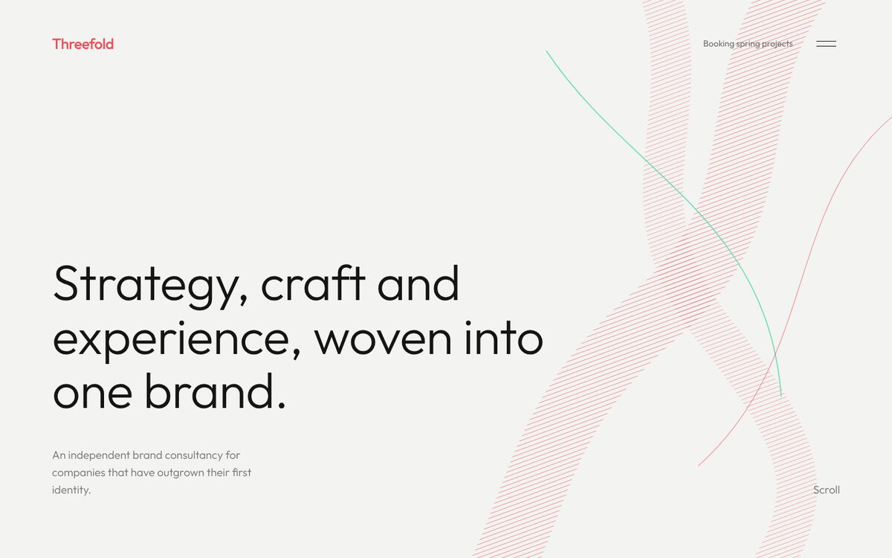</a><br><b>Threefold</b> · Professional Services<br>
<a href="https://letstemplates.com/templates/tailwind/consulting/threefold/demo?utm_campaign=free-templates&amp;utm_content=threefold&amp;utm_medium=readme&amp;utm_source=github">Live demo</a> · <a href="templates/threefold">Code</a> · <a href="https://letstemplates.com/templates/consulting/threefold?utm_campaign=free-templates&amp;utm_content=threefold&amp;utm_medium=readme&amp;utm_source=github">Bootstrap, DaisyUI and Material Design versions</a>
</td>
<td width="50%" valign="top">
<a href="https://letstemplates.com/templates/tailwind/saas/solstra/demo?utm_campaign=free-templates&amp;utm_content=solstra&amp;utm_medium=readme&amp;utm_source=github">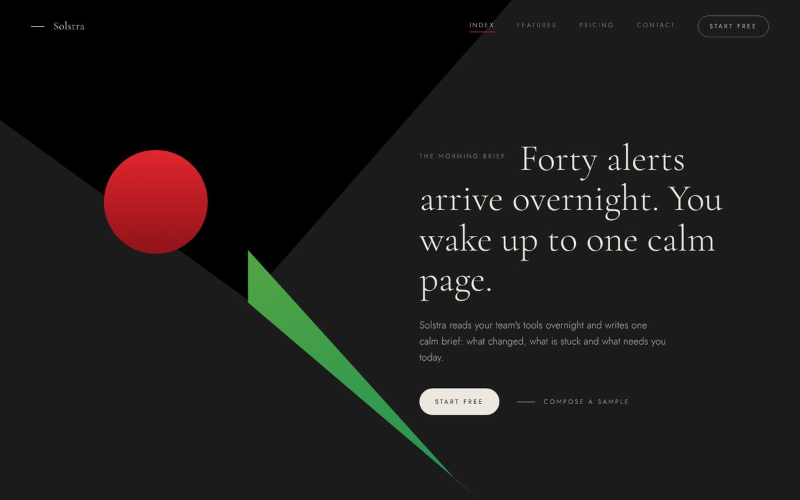</a><br><b>Solstra</b> · SaaS<br>
<a href="https://letstemplates.com/templates/tailwind/saas/solstra/demo?utm_campaign=free-templates&amp;utm_content=solstra&amp;utm_medium=readme&amp;utm_source=github">Live demo</a> · <a href="templates/solstra">Code</a> · <a href="https://letstemplates.com/templates/saas/solstra?utm_campaign=free-templates&amp;utm_content=solstra&amp;utm_medium=readme&amp;utm_source=github">Bootstrap, DaisyUI and Material Design versions</a>
</td>
</tr>
<tr>
<td width="50%" valign="top">
<a href="https://letstemplates.com/templates/tailwind/fintech/farthing/demo?utm_campaign=free-templates&amp;utm_content=farthing&amp;utm_medium=readme&amp;utm_source=github">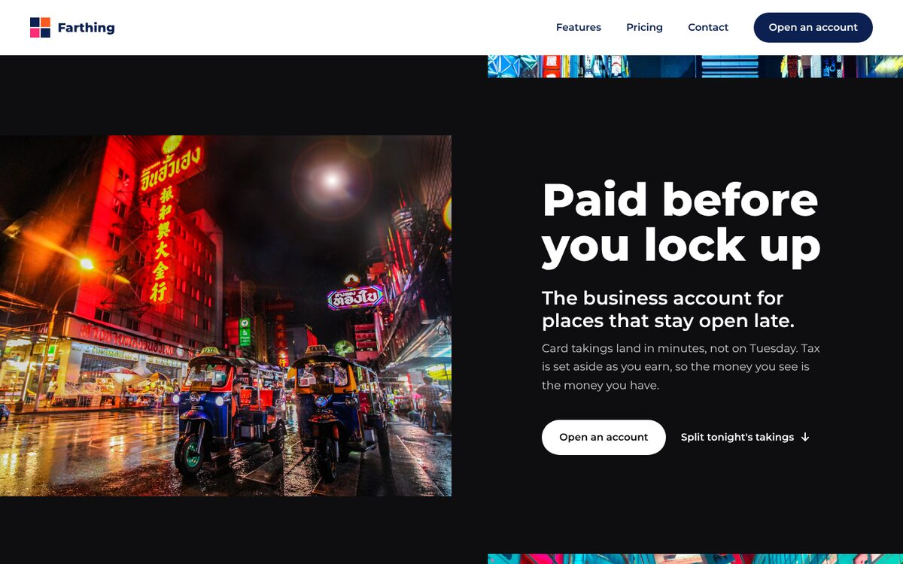</a><br><b>Farthing</b> · Finance &amp; Fintech<br>
<a href="https://letstemplates.com/templates/tailwind/fintech/farthing/demo?utm_campaign=free-templates&amp;utm_content=farthing&amp;utm_medium=readme&amp;utm_source=github">Live demo</a> · <a href="templates/farthing">Code</a> · <a href="https://letstemplates.com/templates/fintech/farthing?utm_campaign=free-templates&amp;utm_content=farthing&amp;utm_medium=readme&amp;utm_source=github">Bootstrap, DaisyUI and Material Design versions</a>
</td>
<td width="50%" valign="top">
<a href="https://letstemplates.com/templates/tailwind/portfolio/quoin/demo?utm_campaign=free-templates&amp;utm_content=quoin&amp;utm_medium=readme&amp;utm_source=github">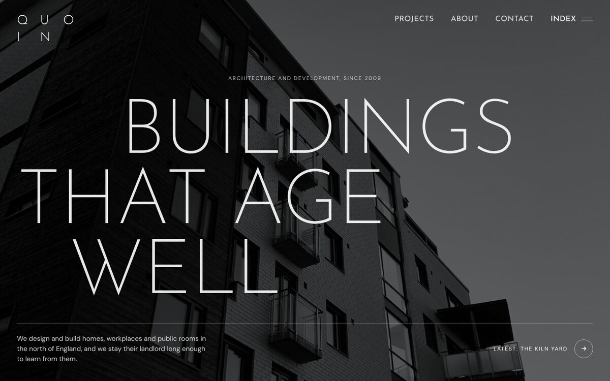</a><br><b>Quoin</b> · Portfolio<br>
<a href="https://letstemplates.com/templates/tailwind/portfolio/quoin/demo?utm_campaign=free-templates&amp;utm_content=quoin&amp;utm_medium=readme&amp;utm_source=github">Live demo</a> · <a href="templates/quoin">Code</a> · <a href="https://letstemplates.com/templates/portfolio/quoin?utm_campaign=free-templates&amp;utm_content=quoin&amp;utm_medium=readme&amp;utm_source=github">Bootstrap, DaisyUI and Material Design versions</a>
</td>
</tr>
<tr>
<td width="50%" valign="top">
<a href="https://letstemplates.com/templates/tailwind/blog/sabela-rooke/demo?utm_campaign=free-templates&amp;utm_content=sabela-rooke&amp;utm_medium=readme&amp;utm_source=github"></a><br><b>Sabela Rooke</b> · Blog<br>
<a href="https://letstemplates.com/templates/tailwind/blog/sabela-rooke/demo?utm_campaign=free-templates&amp;utm_content=sabela-rooke&amp;utm_medium=readme&amp;utm_source=github">Live demo</a> · <a href="templates/sabela-rooke">Code</a> · <a href="https://letstemplates.com/templates/blog/sabela-rooke?utm_campaign=free-templates&amp;utm_content=sabela-rooke&amp;utm_medium=readme&amp;utm_source=github">Bootstrap, DaisyUI and Material Design versions</a>
</td>
<td width="50%" valign="top">
<a href="https://letstemplates.com/templates/tailwind/health-fitness/mintry/demo?utm_campaign=free-templates&amp;utm_content=mintry&amp;utm_medium=readme&amp;utm_source=github"></a><br><b>Mintry</b> · Health &amp; Fitness<br>
<a href="https://letstemplates.com/templates/tailwind/health-fitness/mintry/demo?utm_campaign=free-templates&amp;utm_content=mintry&amp;utm_medium=readme&amp;utm_source=github">Live demo</a> · <a href="templates/mintry">Code</a> · <a href="https://letstemplates.com/templates/health-fitness/mintry?utm_campaign=free-templates&amp;utm_content=mintry&amp;utm_medium=readme&amp;utm_source=github">Bootstrap, DaisyUI and Material Design versions</a>
</td>
</tr>
<tr>
<td width="50%" valign="top">
<a href="https://letstemplates.com/templates/tailwind/saas/beaconry/demo?utm_campaign=free-templates&amp;utm_content=beaconry&amp;utm_medium=readme&amp;utm_source=github"></a><br><b>Beaconry</b> · SaaS<br>
<a href="https://letstemplates.com/templates/tailwind/saas/beaconry/demo?utm_campaign=free-templates&amp;utm_content=beaconry&amp;utm_medium=readme&amp;utm_source=github">Live demo</a> · <a href="templates/beaconry">Code</a> · <a href="https://letstemplates.com/templates/saas/beaconry?utm_campaign=free-templates&amp;utm_content=beaconry&amp;utm_medium=readme&amp;utm_source=github">Bootstrap, DaisyUI and Material Design versions</a>
</td>
<td></td>
</tr>
</table>

## How to use

1. Download this repo (**Code → Download ZIP**) or clone it:
   ```bash
   git clone https://github.com/yesdus/free-tailwind-templates.git
   ```
2. Open `templates/<name>/index.html` in your browser.
3. Edit the HTML. Styles are Tailwind utility classes loaded from the [Tailwind Play CDN](https://tailwindcss.com/docs/installation/play-cdn), and icons come from Font Awesome.

Going to production? Compile the CSS with the [Tailwind CLI](https://tailwindcss.com/docs/installation/tailwind-cli) instead of the CDN script for a smaller, faster page.

## Need more?

Every template here is also available in Bootstrap, DaisyUI and Material Design on [letstemplates.com](https://letstemplates.com/?utm_campaign=free-templates&utm_content=need-more&utm_medium=readme&utm_source=github), next to premium multi-page templates and a library of copy-paste blocks (navbars, heroes, pricing tables, footers…).

## License

[MIT](LICENSE): free for personal and commercial projects. Keeping the small "Built with Let's templates" credit in the footer is optional, but much appreciated.

Photos are loaded from [Unsplash](https://unsplash.com) and covered by the [Unsplash License](https://unsplash.com/license), not by MIT. Replace them with your own before going live.

Found a bug? [Open an issue](../../issues).
