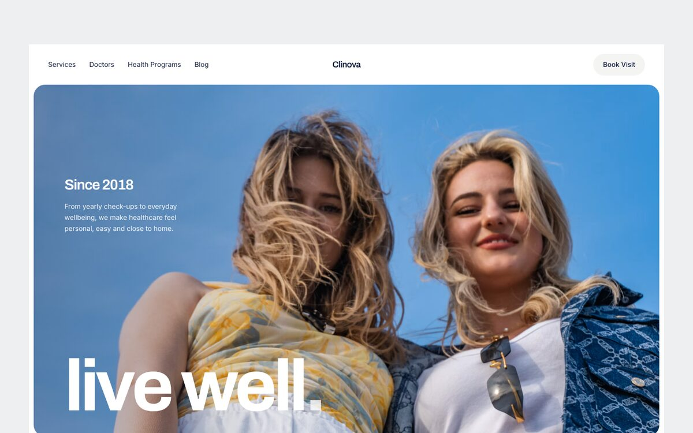
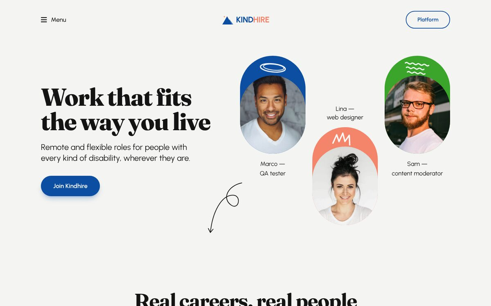
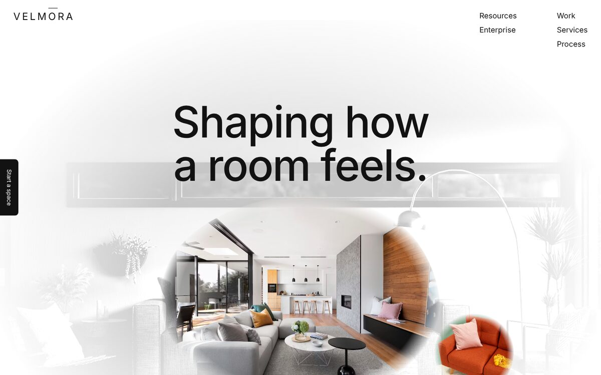
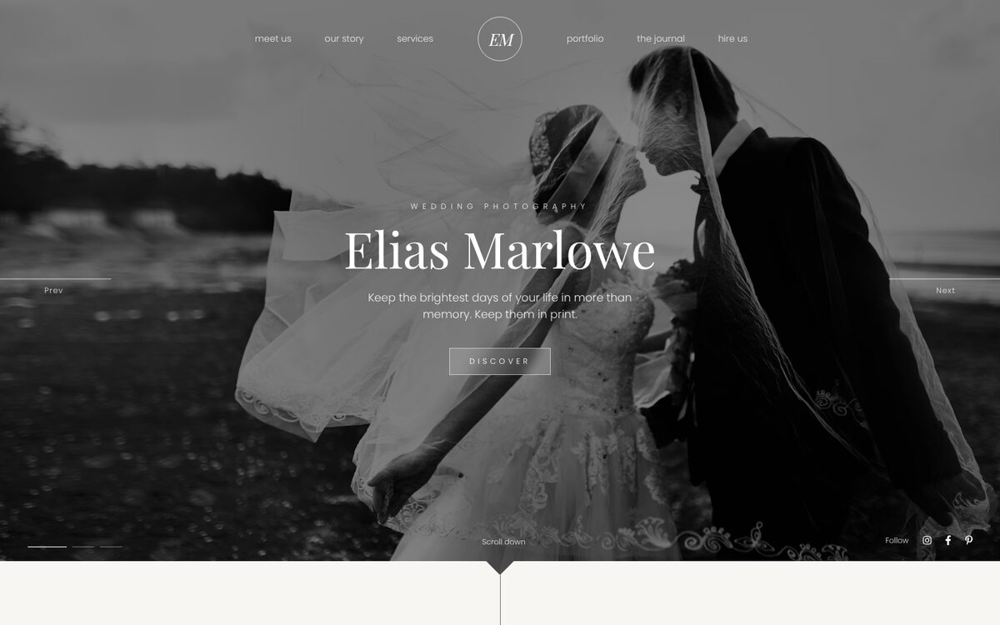
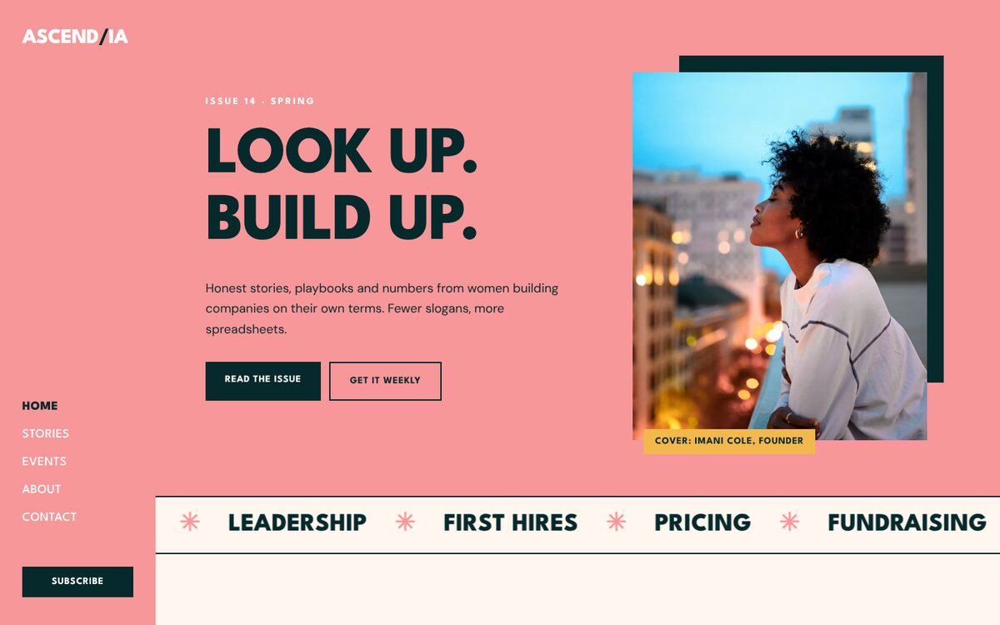
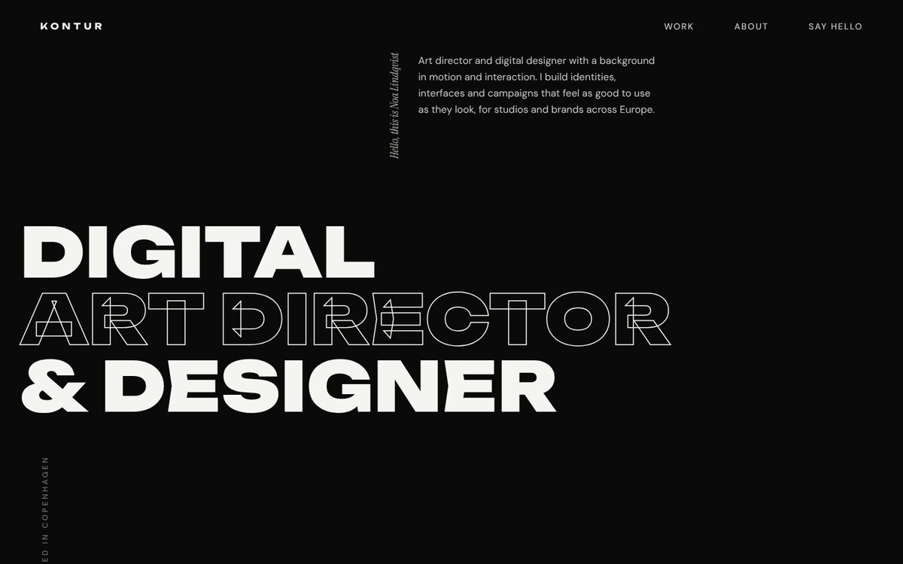
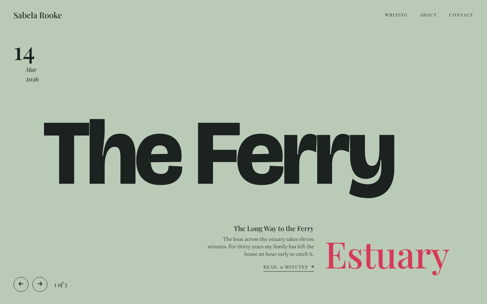

# Free Tailwind CSS Templates

14 free, responsive website templates built with [Tailwind CSS](https://tailwindcss.com), for Agency, Portfolio, Blog, Business, Health & Fitness and more sites. Plain HTML, no build step: open `index.html` and start editing.

Made by [Let's templates](https://letstemplates.com/?utm_campaign=free-templates&utm_content=intro&utm_medium=readme&utm_source=github), where you'll find 150+ templates in Tailwind CSS, Bootstrap 5, DaisyUI and Material Design.

⭐ **If these templates save you time, star the repo** so more people can find them.

## Templates

<table>
<tr>
<td width="50%" valign="top">
<a href="https://letstemplates.com/templates/tailwind/health-fitness/clinova/demo?utm_campaign=free-templates&amp;utm_content=clinova&amp;utm_medium=readme&amp;utm_source=github"></a><br><b>Clinova</b> · Health &amp; Fitness<br>
<a href="https://letstemplates.com/templates/tailwind/health-fitness/clinova/demo?utm_campaign=free-templates&amp;utm_content=clinova&amp;utm_medium=readme&amp;utm_source=github">Live demo</a> · <a href="templates/clinova">Code</a> · <a href="https://letstemplates.com/templates/health-fitness/clinova?utm_campaign=free-templates&amp;utm_content=clinova&amp;utm_medium=readme&amp;utm_source=github">Bootstrap, DaisyUI and Material Design versions</a>
</td>
<td width="50%" valign="top">
<a href="https://letstemplates.com/templates/tailwind/agency/sproutline/demo?utm_campaign=free-templates&amp;utm_content=sproutline&amp;utm_medium=readme&amp;utm_source=github"></a><br><b>Sproutline</b> · Agency<br>
<a href="https://letstemplates.com/templates/tailwind/agency/sproutline/demo?utm_campaign=free-templates&amp;utm_content=sproutline&amp;utm_medium=readme&amp;utm_source=github">Live demo</a> · <a href="templates/sproutline">Code</a> · <a href="https://letstemplates.com/templates/agency/sproutline?utm_campaign=free-templates&amp;utm_content=sproutline&amp;utm_medium=readme&amp;utm_source=github">Bootstrap, DaisyUI and Material Design versions</a>
</td>
</tr>
<tr>
<td width="50%" valign="top">
<a href="https://letstemplates.com/templates/tailwind/business/kindhire/demo?utm_campaign=free-templates&amp;utm_content=kindhire&amp;utm_medium=readme&amp;utm_source=github"></a><br><b>Kindhire</b> · Business<br>
<a href="https://letstemplates.com/templates/tailwind/business/kindhire/demo?utm_campaign=free-templates&amp;utm_content=kindhire&amp;utm_medium=readme&amp;utm_source=github">Live demo</a> · <a href="templates/kindhire">Code</a> · <a href="https://letstemplates.com/templates/business/kindhire?utm_campaign=free-templates&amp;utm_content=kindhire&amp;utm_medium=readme&amp;utm_source=github">Bootstrap, DaisyUI and Material Design versions</a>
</td>
<td width="50%" valign="top">
<a href="https://letstemplates.com/templates/tailwind/agency/velmora/demo?utm_campaign=free-templates&amp;utm_content=velmora&amp;utm_medium=readme&amp;utm_source=github"></a><br><b>Velmora</b> · Agency<br>
<a href="https://letstemplates.com/templates/tailwind/agency/velmora/demo?utm_campaign=free-templates&amp;utm_content=velmora&amp;utm_medium=readme&amp;utm_source=github">Live demo</a> · <a href="templates/velmora">Code</a> · <a href="https://letstemplates.com/templates/agency/velmora?utm_campaign=free-templates&amp;utm_content=velmora&amp;utm_medium=readme&amp;utm_source=github">Bootstrap, DaisyUI and Material Design versions</a>
</td>
</tr>
<tr>
<td width="50%" valign="top">
<a href="https://letstemplates.com/templates/tailwind/portfolio/emberlyn/demo?utm_campaign=free-templates&amp;utm_content=emberlyn&amp;utm_medium=readme&amp;utm_source=github"></a><br><b>Emberlyn</b> · Portfolio<br>
<a href="https://letstemplates.com/templates/tailwind/portfolio/emberlyn/demo?utm_campaign=free-templates&amp;utm_content=emberlyn&amp;utm_medium=readme&amp;utm_source=github">Live demo</a> · <a href="templates/emberlyn">Code</a> · <a href="https://letstemplates.com/templates/portfolio/emberlyn?utm_campaign=free-templates&amp;utm_content=emberlyn&amp;utm_medium=readme&amp;utm_source=github">Bootstrap, DaisyUI and Material Design versions</a>
</td>
<td width="50%" valign="top">
<a href="https://letstemplates.com/templates/tailwind/agency/velvoro/demo?utm_campaign=free-templates&amp;utm_content=velvoro&amp;utm_medium=readme&amp;utm_source=github"></a><br><b>Velvoro</b> · Agency<br>
<a href="https://letstemplates.com/templates/tailwind/agency/velvoro/demo?utm_campaign=free-templates&amp;utm_content=velvoro&amp;utm_medium=readme&amp;utm_source=github">Live demo</a> · <a href="templates/velvoro">Code</a> · <a href="https://letstemplates.com/templates/agency/velvoro?utm_campaign=free-templates&amp;utm_content=velvoro&amp;utm_medium=readme&amp;utm_source=github">Bootstrap, DaisyUI and Material Design versions</a>
</td>
</tr>
<tr>
<td width="50%" valign="top">
<a href="https://letstemplates.com/templates/tailwind/business/brassmoor/demo?utm_campaign=free-templates&amp;utm_content=brassmoor&amp;utm_medium=readme&amp;utm_source=github"></a><br><b>Brassmoor</b> · Business<br>
<a href="https://letstemplates.com/templates/tailwind/business/brassmoor/demo?utm_campaign=free-templates&amp;utm_content=brassmoor&amp;utm_medium=readme&amp;utm_source=github">Live demo</a> · <a href="templates/brassmoor">Code</a> · <a href="https://letstemplates.com/templates/business/brassmoor?utm_campaign=free-templates&amp;utm_content=brassmoor&amp;utm_medium=readme&amp;utm_source=github">Bootstrap, DaisyUI and Material Design versions</a>
</td>
<td width="50%" valign="top">
<a href="https://letstemplates.com/templates/tailwind/blog/ascendia/demo?utm_campaign=free-templates&amp;utm_content=ascendia&amp;utm_medium=readme&amp;utm_source=github"></a><br><b>Ascendia</b> · Blog<br>
<a href="https://letstemplates.com/templates/tailwind/blog/ascendia/demo?utm_campaign=free-templates&amp;utm_content=ascendia&amp;utm_medium=readme&amp;utm_source=github">Live demo</a> · <a href="templates/ascendia">Code</a> · <a href="https://letstemplates.com/templates/blog/ascendia?utm_campaign=free-templates&amp;utm_content=ascendia&amp;utm_medium=readme&amp;utm_source=github">Bootstrap, DaisyUI and Material Design versions</a>
</td>
</tr>
<tr>
<td width="50%" valign="top">
<a href="https://letstemplates.com/templates/tailwind/health-fitness/aeris/demo?utm_campaign=free-templates&amp;utm_content=aeris&amp;utm_medium=readme&amp;utm_source=github"></a><br><b>Aeris</b> · Health &amp; Fitness<br>
<a href="https://letstemplates.com/templates/tailwind/health-fitness/aeris/demo?utm_campaign=free-templates&amp;utm_content=aeris&amp;utm_medium=readme&amp;utm_source=github">Live demo</a> · <a href="templates/aeris">Code</a> · <a href="https://letstemplates.com/templates/health-fitness/aeris?utm_campaign=free-templates&amp;utm_content=aeris&amp;utm_medium=readme&amp;utm_source=github">Bootstrap, DaisyUI and Material Design versions</a>
</td>
<td width="50%" valign="top">
<a href="https://letstemplates.com/templates/tailwind/portfolio/kontur/demo?utm_campaign=free-templates&amp;utm_content=kontur&amp;utm_medium=readme&amp;utm_source=github"></a><br><b>Kontur</b> · Portfolio<br>
<a href="https://letstemplates.com/templates/tailwind/portfolio/kontur/demo?utm_campaign=free-templates&amp;utm_content=kontur&amp;utm_medium=readme&amp;utm_source=github">Live demo</a> · <a href="templates/kontur">Code</a> · <a href="https://letstemplates.com/templates/portfolio/kontur?utm_campaign=free-templates&amp;utm_content=kontur&amp;utm_medium=readme&amp;utm_source=github">Bootstrap, DaisyUI and Material Design versions</a>
</td>
</tr>
<tr>
<td width="50%" valign="top">
<a href="https://letstemplates.com/templates/tailwind/ecommerce/saltmere/demo?utm_campaign=free-templates&amp;utm_content=saltmere&amp;utm_medium=readme&amp;utm_source=github"></a><br><b>Saltmere</b> · E-commerce<br>
<a href="https://letstemplates.com/templates/tailwind/ecommerce/saltmere/demo?utm_campaign=free-templates&amp;utm_content=saltmere&amp;utm_medium=readme&amp;utm_source=github">Live demo</a> · <a href="templates/saltmere">Code</a> · <a href="https://letstemplates.com/templates/ecommerce/saltmere?utm_campaign=free-templates&amp;utm_content=saltmere&amp;utm_medium=readme&amp;utm_source=github">Bootstrap, DaisyUI and Material Design versions</a>
</td>
<td width="50%" valign="top">
<a href="https://letstemplates.com/templates/tailwind/portfolio/quoin/demo?utm_campaign=free-templates&amp;utm_content=quoin&amp;utm_medium=readme&amp;utm_source=github"></a><br><b>Quoin</b> · Portfolio<br>
<a href="https://letstemplates.com/templates/tailwind/portfolio/quoin/demo?utm_campaign=free-templates&amp;utm_content=quoin&amp;utm_medium=readme&amp;utm_source=github">Live demo</a> · <a href="templates/quoin">Code</a> · <a href="https://letstemplates.com/templates/portfolio/quoin?utm_campaign=free-templates&amp;utm_content=quoin&amp;utm_medium=readme&amp;utm_source=github">Bootstrap, DaisyUI and Material Design versions</a>
</td>
</tr>
<tr>
<td width="50%" valign="top">
<a href="https://letstemplates.com/templates/tailwind/blog/sabela-rooke/demo?utm_campaign=free-templates&amp;utm_content=sabela-rooke&amp;utm_medium=readme&amp;utm_source=github"></a><br><b>Sabela Rooke</b> · Blog<br>
<a href="https://letstemplates.com/templates/tailwind/blog/sabela-rooke/demo?utm_campaign=free-templates&amp;utm_content=sabela-rooke&amp;utm_medium=readme&amp;utm_source=github">Live demo</a> · <a href="templates/sabela-rooke">Code</a> · <a href="https://letstemplates.com/templates/blog/sabela-rooke?utm_campaign=free-templates&amp;utm_content=sabela-rooke&amp;utm_medium=readme&amp;utm_source=github">Bootstrap, DaisyUI and Material Design versions</a>
</td>
<td width="50%" valign="top">
<a href="https://letstemplates.com/templates/tailwind/saas/beaconry/demo?utm_campaign=free-templates&amp;utm_content=beaconry&amp;utm_medium=readme&amp;utm_source=github"></a><br><b>Beaconry</b> · SaaS<br>
<a href="https://letstemplates.com/templates/tailwind/saas/beaconry/demo?utm_campaign=free-templates&amp;utm_content=beaconry&amp;utm_medium=readme&amp;utm_source=github">Live demo</a> · <a href="templates/beaconry">Code</a> · <a href="https://letstemplates.com/templates/saas/beaconry?utm_campaign=free-templates&amp;utm_content=beaconry&amp;utm_medium=readme&amp;utm_source=github">Bootstrap, DaisyUI and Material Design versions</a>
</td>
</tr>
</table>

## How to use

1. Download this repo (**Code → Download ZIP**) or clone it:
   ```bash
   git clone https://github.com/yesdus/free-tailwind-templates.git
   ```
2. Open `templates/<name>/index.html` in your browser.
3. Edit the HTML. Styles are Tailwind utility classes loaded from the [Tailwind Play CDN](https://tailwindcss.com/docs/installation/play-cdn), and icons come from Font Awesome.

Going to production? Compile the CSS with the [Tailwind CLI](https://tailwindcss.com/docs/installation/tailwind-cli) instead of the CDN script for a smaller, faster page.

## Need more?

Every template here is also available in Bootstrap, DaisyUI and Material Design on [letstemplates.com](https://letstemplates.com/?utm_campaign=free-templates&utm_content=need-more&utm_medium=readme&utm_source=github), next to premium multi-page templates and a library of copy-paste blocks (navbars, heroes, pricing tables, footers…).

## License

[MIT](LICENSE): free for personal and commercial projects. Keeping the small "Built with Let's templates" credit in the footer is optional, but much appreciated.

Photos are loaded from [Unsplash](https://unsplash.com) and covered by the [Unsplash License](https://unsplash.com/license), not by MIT. Replace them with your own before going live.

Found a bug? [Open an issue](../../issues).
